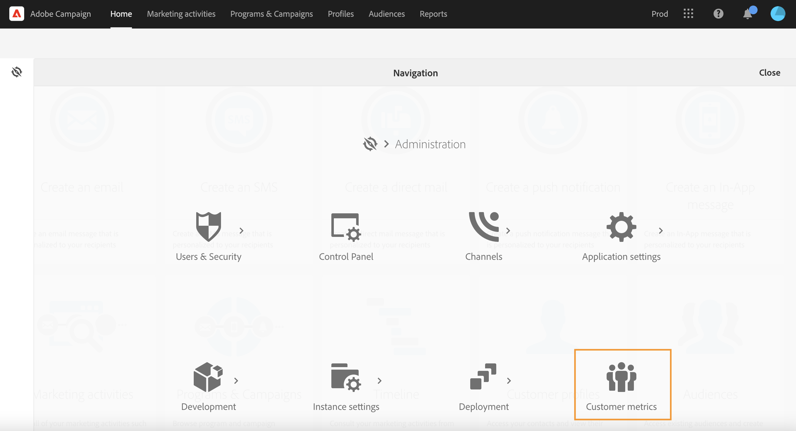
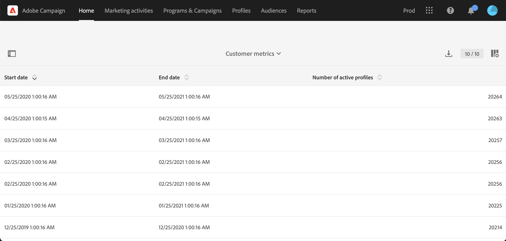

# Profili attivi{#active-profiles}

È possibile accedere ai dettagli dei profili attivi dal report **[!UICONTROL Customer metrics]**. Questo rapporto è disponibile solo per gli amministratori funzionali di Campaign. Per accedere a questo report, fare clic sull&#39;icona Adobe Campaign in alto a sinistra nell&#39;[interfaccia utente](../../start/using/interface-description.md#advanced-menu) e passare a **[!UICONTROL Administration > Customer metrics]**.

Questo report viene generato ogni mese dal flusso di lavoro tecnico **[!UICONTROL Billing]** e visualizza il numero di **profili attivi**. Ulteriori informazioni sui flussi di lavoro tecnici in [questa pagina](../../administration/using/technical-workflows.md).

Un &quot;profilo&quot; è un record di informazioni che rappresenta un cliente finale, potenziale cliente o lead. I profili sono considerati **attivi** se sono stati targetizzati da una consegna Campaign negli ultimi 12 mesi tramite qualsiasi canale.

In base al contratto, a ciascuna istanza di Campaign viene fornito un numero specifico di profili attivi. Per informazioni sul numero di profili attivi acquistati, fai riferimento al contratto di licenza.

* I profili esclusi durante la preparazione della consegna (ad esempio per regole di tipologia o meccanismo di quarantena) non vengono presi in considerazione.

* I destinatari dei messaggi transazionali vengono conteggiati nei profili attivi.

* Un profilo che è stato oggetto di targeting per diverse consegne verrà conteggiato una sola volta.

* Questo report è solo informativo, non ha un impatto diretto sulla fatturazione.

Nella parte inferiore della pagina, sono elencate le dimensioni di targeting con il numero di profili per ciascuno di essi. I destinatari dei messaggi transazionali sono associati alla dimensione **Anonimo**.

>[!NOTE]
>
>In qualità di utente amministratore, puoi anche monitorare il numero di profili attivi utilizzati sulle istanze direttamente dal Pannello di controllo Campaign. Per ulteriori informazioni, consulta la [documentazione del Pannello di controllo Campaign](https://experienceleague.adobe.com/docs/control-panel/using/performance-monitoring/active-profiles-monitoring.html).
>
