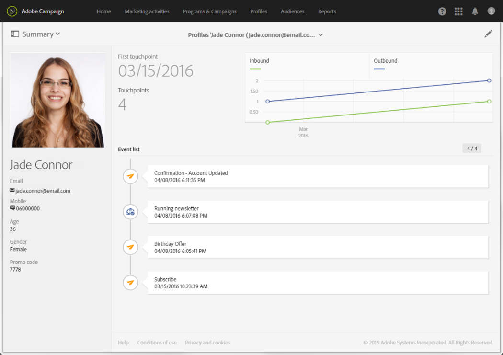

# Integrated Customer Profile{#integrated-customer-profile}

Per ogni contatto del database è disponibile un Integrated customer profile. Questo storico dei dati marketing combina in un’unica visualizzazione tutte le informazioni di marketing rilevanti che riguardano il contatto con un cliente. Potrai quindi accedere da una posizione centrale a tutti i comportamenti digitali e alle transazioni online e offline: informazioni di contatto, e-mail ricevute, registri di tracciamento, abbonamenti e annullamenti degli abbonamenti e così via.

Per accedere all’Integrated customer profile, effettua le seguenti operazioni:

1. Dalla home page di Adobe Campaign, fare clic sulla scheda **[!UICONTROL Customer profiles]** o sulla scheda **Profili** per visualizzare l&#39;elenco dei profili.

1. Per cercare un profilo in base a un campo specifico, apri il riquadro di ricerca, quindi seleziona il campo in cui desideri eseguire la ricerca.

   

1. Specifica il valore da cercare, quindi premi Invio.

   >[!NOTE]
   >
   >Tieni presente che le ricerche possono essere eseguite in base ai campi e-mail, nome e cognome, nonché ai campi personalizzati aggiunti durante l’estensione della risorsa.
   >
   >Le ricerche fanno distinzione tra maiuscole e minuscole e vengono eseguite solo sui prefissi. Ad esempio, non potrai cercare un profilo utilizzando le ultime lettere del cognome.

1. Seleziona un contatto per aprirne il profilo.

   

Adesso potrai accedere allo **storico dei dati marketing** di questo contatto.

In questa pagina sono raccolte le informazioni chiave sul profilo, oltre all’elenco degli eventi.

Fai clic su un evento nell’elenco per aprirlo: puoi accedere ai messaggi inviati o ai servizi a cui è abbonato il profilo.

>[!NOTE]
>
>Lo storico dei dati marketing è accessibile anche tramite l’API Adobe Campaign Standard. Per ulteriori informazioni, consulta la [documentazione dedicata](../../api/using/interacting-with-marketing-history.md).
