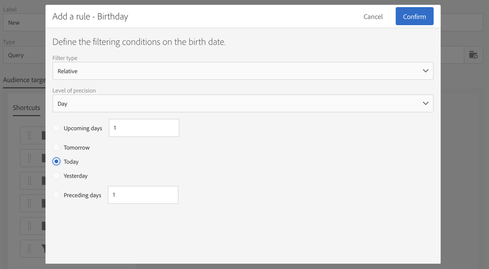

# Consegna compleanno {#birthday-delivery}

Questo esempio è un flusso di lavoro di compleanno. Ogni giorno un’e-mail viene inviata ai profili che compiono gli anni in quel giorno.

Per creare il flusso di lavoro, effettua le seguenti operazioni:

* L&#39;[Utilità di pianificazione](../../automating/using/scheduler.md) ti consente di avviare il flusso di lavoro ogni giorno alle 8.

  

* L&#39;attività [Query](../../automating/using/query.md) ti consente di calcolare i profili che hanno fornito un&#39;e-mail e il cui compleanno cade nel giorno corrente ogni volta che il flusso di lavoro viene eseguito. Il calcolo del compleanno viene eseguito utilizzando un filtro predefinito disponibile nella palette nello strumento di modifica delle query.

  

* La [consegna e-mail](../../automating/using/email-delivery.md) è ricorrente. Gli invii sono aggregati per mese. In questo modo, tutte le e-mail inviate in un mese vengono aggregate in un’unica vista. In un anno vengono quindi eseguite 365 consegne, che vengono raggruppate in 12 viste (dette anche **esecuzioni ricorrenti**) nell’interfaccia di Adobe Campaign. La cronologia e i dettagli sui report vengono visualizzati ogni mese e non per ogni invio.

  
