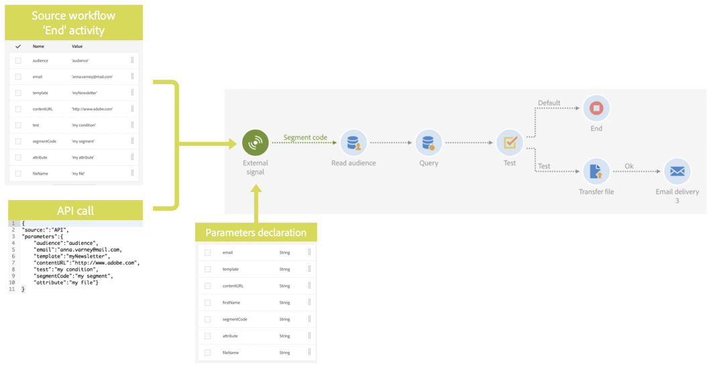

# Panoramica {#calling-a-workflow-with-external-parameters}

Campaign Standard consente di chiamare un flusso di lavoro con parametri (un nome di pubblico per il target, un nome di file da importare, una parte del contenuto del messaggio, ecc.). In questo modo, puoi integrare facilmente le automazioni di Campaign con il sistema esterno.

Prendiamo l’esempio seguente, in cui vogliamo inviare le e-mail direttamente da un CMS. In tal caso, puoi configurare il sistema per selezionare il pubblico e il contenuto dell’e-mail in CMS. Facendo clic su Invia verrà quindi richiamato un flusso di lavoro di Campaign con questi parametri, che potrai utilizzare nel flusso di lavoro per definire il pubblico e il contenuto dell’URL da utilizzare nella consegna.

Il processo per chiamare un flusso di lavoro con parametri è il seguente:

1. Dichiarare i parametri nell&#39;attività **[!UICONTROL External signal]**. Vedere [Dichiarazione dei parametri nell&#39;attività External signal](../../automating/using/declaring-parameters-external-signal.md).
1. Configurare l&#39;attività **[!UICONTROL End]** o la chiamata API per definire i parametri e attivare l&#39;attività **[!UICONTROL External signal]** del flusso di lavoro. Vedi [questa pagina](../../automating/using/defining-parameters-calling-workflow.md)
1. Una volta attivato il flusso di lavoro, i parametri vengono acquisiti nelle variabili degli eventi del flusso di lavoro e possono essere utilizzati all’interno del flusso di lavoro. Consulta [questa pagina](../../automating/using/customizing-workflow-external-parameters.md).

