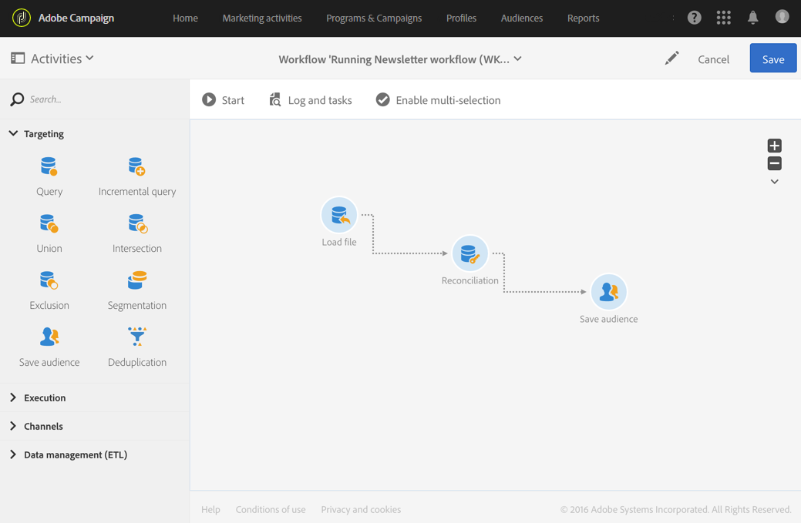

# Aggiornamento dei dati tramite riconciliazione {#data-update-reconciliation}

L’esempio seguente illustra un flusso di lavoro che crea un pubblico di profili direttamente da un file importato contenente nuovi clienti. È costituito dalle seguenti attività:



* Un&#39;attività [Load file](../../automating/using/load-file.md) che carica e rileva i dati del file da importare. Il file importato contiene i dati seguenti:

  ```
  lastname;firstname;email;dateofbirth
  jackman;megan;megan.jackman@testmail.com;07/08/1975
  phillips;edward;phillips@testmail.com;09/03/1986
  weaver;justin;justin_w@testmail.com;11/15/1990
  martin;babeth;babeth_martin@testmail.net;11/25/1964
  reese;richard;rreese@testmail.com;02/08/1987
  cage;nathalie;cage.nathalie227@testmail.com;07/03/1989
  xiuxiu;andrea;andrea.xiuxiu@testmail.com;09/12/1992
  grimes;daryl;daryl_890@testmail.com;12/06/1979
  tycoon;tyreese;tyreese_t@testmail.net;10/08/1971
  ```

* Un&#39;attività [Reconciliation](../../automating/using/reconciliation.md), che collega ogni colonna del file caricato a una colonna della dimensione del profilo. Record di file che non è possibile identificare (dati mancanti, tipo di dati incompatibile, ecc.) vengono ignorati per preservare l’integrità dei dati di pubblico finali.

  

* Un&#39;attività [Save audience](../../automating/using/save-audience.md), che consente di salvare il pubblico di profili.

  
