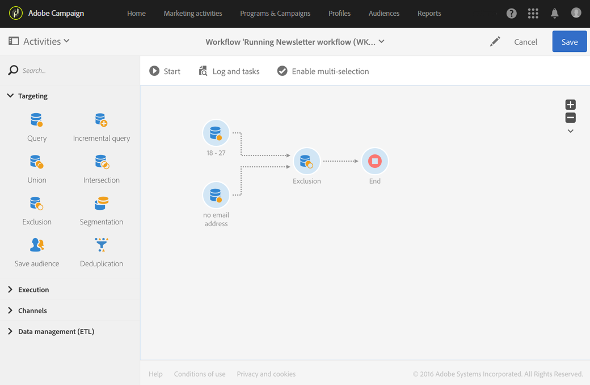

# Esclusione{#exclusion}

## Descrizione {#description}

L’attività **[!UICONTROL Exclusion]** consente di escludere elementi da una popolazione in base a determinati criteri.

## Contesto di utilizzo {#context-of-use}

L’attività **[!UICONTROL Exclusion]** è utilizzata essenzialmente per eseguire un filtraggio aggiuntivo sulle popolazioni di transizione in entrata.

Un set primario è definito tra le transizioni in entrata. I membri di altre transizioni in entrata sono esclusi dal set primario. La transizione in uscita dell’attività di esclusione contiene solo i membri del set primario che non sono stati incontrati nelle altre transizioni in entrata.

## Configurazione {#configuration}

1. Trascina e rilascia un’attività **[!UICONTROL Exclusion]** nel flusso di lavoro.
1. Seleziona l’attività, quindi aprila utilizzando il pulsante  delle azioni rapide visualizzate.
1. Seleziona il **[!UICONTROL Primary set]** dalle transizioni in entrata. Questo è il set da cui gli elementi sono esclusi. Gli altri set confrontano gli elementi prima che vengano esclusi dal set primario.

   >[!NOTE]
   >
   >Le transizioni in entrata devono contenere lo stesso tipo di popolazione. Ad esempio, se il set primario contiene profili di test, anche le altre transizioni devono contenere profili di test.

1. Se necessario, gestisci le [Transizioni](../../automating/using/activity-properties.md) dell’attività per accedere alle opzioni avanzate per la popolazione in uscita.
1. Conferma la configurazione dell’attività e salva il flusso di lavoro.

## Esempio {#example}

L’esempio seguente mostra due attività di query configurate per filtrare dal database di Adobe Campaign i profili che hanno tra i 18 e i 27 anni e dispongono di un indirizzo e-mail non valido. I profili con indirizzi e-mail non validi sono quindi esclusi dal primo set. Ciò consente ad esempio di inviare un messaggio e-mail.

