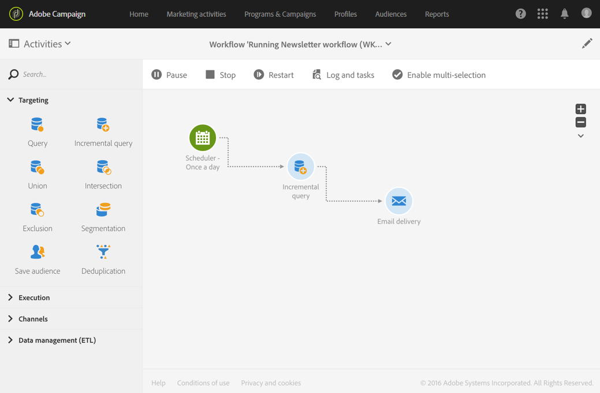

# Comandi di esecuzione {#execution-commands}

Le icone nella barra delle azioni ti consentono di avviare, tracciare e modificare l’esecuzione di un flusso di lavoro. Vedi [Barra delle azioni](../../automating/using/workflow-interface.md#action-bar).

Le azioni disponibili sono le seguenti:

**Inizio**

Il pulsante  avvia l&#39;esecuzione di un flusso di lavoro che assume lo stato **In corso** (blu). Se il flusso di lavoro è stato messo in pausa, viene ripristinato, altrimenti viene avviato e le attività iniziali vengono quindi attivate.

>[!NOTE]
>
>L’avvio è un processo asincrono: la richiesta viene salvata e verrà elaborata il prima possibile dal motore di esecuzione del flusso di lavoro.

**Pausa**

Il pulsante  sospende l&#39;esecuzione. Il flusso di lavoro assume lo stato **Avviso** (giallo). Non verranno attivate nuove attività finché non viene ripresa, ma le operazioni in corso non vengono sospese.

**Interrompi**

Il pulsante  interrompe un flusso di lavoro in esecuzione che assume lo stato **Completato** (verde). Le operazioni in corso vengono interrotte, se possibile, e le importazioni o le query SQL in corso vengono immediatamente annullate. Non è possibile riprendere dal flusso di lavoro dalla stessa posizione in cui è stato interrotto.

**Riavvia**

Il pulsante  prevede l&#39;arresto e il riavvio di un flusso di lavoro. Nella maggior parte dei casi, questo consente di riavviare il sistema più rapidamente. Può inoltre essere utile automatizzare il riavvio quando l&#39;arresto richiede un certo periodo di tempo, perché il pulsante  è disponibile solo quando l&#39;arresto è effettivo.

Quando selezioni una o più attività in un flusso di lavoro, puoi eseguire altre azioni, ad esempio:

**Esecuzione immediata**

Il pulsante  avvia tutte le attività in sospeso selezionate il prima possibile.

**Esecuzione normale**

Il pulsante  riattiva tutte le attività in pausa o disattivate.

**Esecuzione sospesa**

Il pulsante  mette in pausa il flusso di lavoro nell&#39;attività selezionata: questa attività e tutte quelle che la seguono (nello stesso ramo) non vengono eseguite.

**Nessuna esecuzione**

Il pulsante  disattiva tutte le attività selezionate.

>[!NOTE]
>
>Le azioni rapide consentono di accedere a diverse azioni relative a una particolare attività e vengono visualizzate quando si seleziona un’attività.
