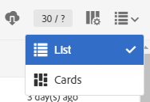
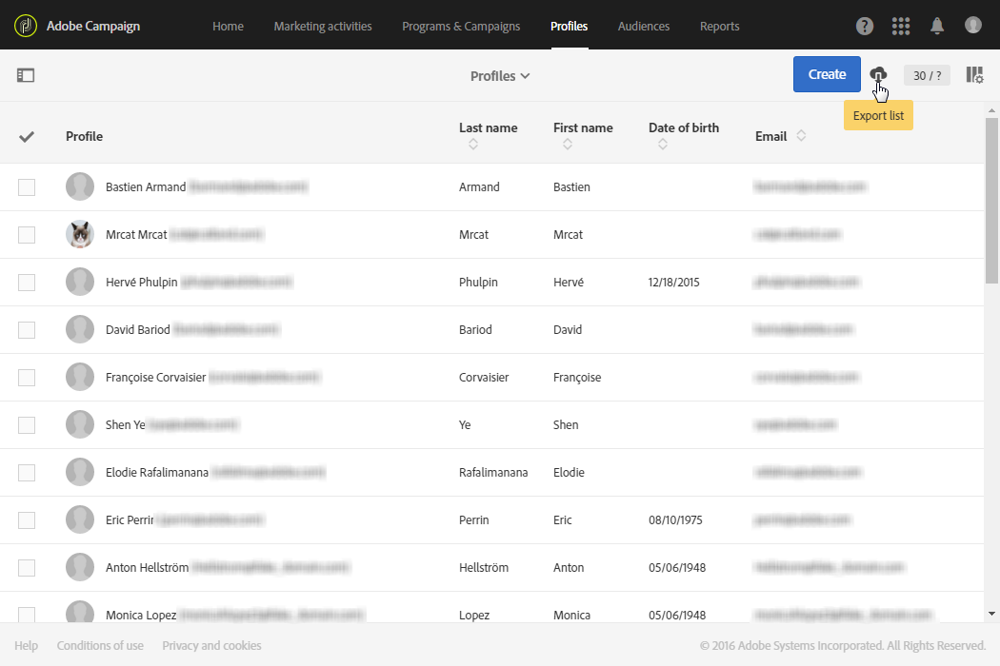

# Esportazione di elenchi{#exporting-lists}

Adobe Campaign consente di esportare gli elenchi direttamente in un file per utilizzi futuri. L&#39;esportazione di un elenco in un file genera una voce di registro nel menu **[!UICONTROL Export audits]**. Per ulteriori informazioni sui controlli delle esportazioni, consulta la sezione [Controllo delle esportazioni](../../administration/using/auditing-export-logs.md).

 [Scopri come configurare un elenco nel video](#video)

L&#39;opzione di esportazione dell&#39;elenco consente di esportare un massimo di 100.000 righe per impostazione predefinita ed è definita dall&#39;opzione **Nms_ExportListLimit**. Questa opzione può essere gestita dall&#39;amministratore funzionale nel menu **[!UICONTROL Administration]** > **[!UICONTROL Application settings]** > **[!UICONTROL Options]**.

L&#39;elenco di esportazione è disponibile in tutte le schermate che hanno una visualizzazione in modalità **Elenco**, per gli utenti con il ruolo **[!UICONTROL EXPORT (export)]**.

1. Vai alla schermata **Elenco** selezionata. Ad esempio, la schermata di panoramica del profilo di test ( **[!UICONTROL Profiles & audiences]** > **[!UICONTROL Test profiles]** ).
1. Verificare che la schermata sia in modalità **Elenco**.

   

1. Organizzare le colonne dell&#39;elenco nell&#39;ordine in cui si desidera esportarle utilizzando il pulsante **[!UICONTROL Configure list]** nell&#39;angolo in alto a destra. Oltre alle colonne configurate, verrà esportata anche la chiave primaria della risorsa.
1. Puoi anche applicare un filtro. A questo scopo, fai clic sul pulsante nell’angolo in alto a sinistra per visualizzare il riquadro di ricerca.

   Se esegui un’esportazione da un elenco contenente risorse diverse, devi applicare i filtri in modo che nell’elenco venga visualizzato un solo tipo di risorsa.

1. Se lo desideri, ordina le colonne scelte.
1. Selezionare il pulsante di esportazione .

   Viene visualizzata una finestra a comparsa per confermare l’esportazione. Una volta confermata l&#39;esportazione, il file viene scaricato automaticamente sul computer.

Il file viene generato in formato CSV con estensione .TXT. Viene denominato in base alla risorsa esportata e alla data di esportazione. Ad esempio: il nome profileBase_20150426_120253.txt verrà applicato a un’esportazione di profili eseguita il 26 aprile 2015 alle ore 12:02:53. È codificato nel formato UTF-8.

I valori numerici e le date tengono conto dell’ora locale (locale) dell’utente che esegue l’esportazione. Ad esempio: GG-MM-AAAA o MM-GG-AAAA.

Per eseguire un’esportazione di dimensioni maggiori di questa, devi creare un flusso di lavoro dedicato. Consulta la sezione [Extract file](../../automating/using/extract-file.md).

**Esempio**

L’esempio seguente è un’esportazione eseguita dall’elenco dei profili definito di seguito:

* Colonne visualizzate (in ordine): Cognome, Nome, Data di nascita, Indirizzo e-mail.
* I nomi sono ordinati in ordine alfabetico.



Il file generato viene presentato come segue (per i primi dieci record):

```
Last name;First name;Birth date;Email;Zip code
Abalo;Patrick;11/11/1941 02:00:00;patrick.a@testmail.com;29200
Abasq;Joel;21/08/1977 02:00:00;abasq.joel@testmail.com;92160
Abernot;John;12/07/1963 01:00:00;john.abernot@testmail.com;78510
Abiven;Christian;16/03/1975 01:00:00;chris.a@mailtest.com;35000
Abouvier;Peter;02/07/1975 01:00:00;pabouvier@mailtest.com;94560
Accardi;Mike;22/06/1948 01:00:00;mike.accardi@mail.com;76400
Accremont;Frank;27/04/1947 01:00:00;accr.frank@mailtest.com;13500
Adam;Daniel;17/09/1953 01:00:00;danieladam@mail.com;17000
Adama;Pascal;22/01/1990 01:00:00;adapascal@mailtest.com;75012
Adama;Henry;22/09/1992 02:00:00;henry.adama@mail.com;64120
```

**Argomenti correlati:**

* [Ruoli](../../administration/using/list-of-roles.md)
* [Personalizzazione degli elenchi](../../start/using/customizing-lists.md)

## Video tutorial {#video}

Questo video mostra come configurare gli elenchi.

>[!VIDEO](https://video.tv.adobe.com/v/329664/?captions=ita&quality=12)

Ulteriori video dimostrativi di Campaign Standard sono disponibili [qui](https://experienceleague.adobe.com/docs/campaign-standard-learn/tutorials/overview.html?lang=it).
