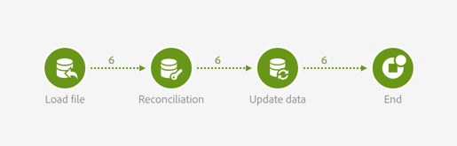
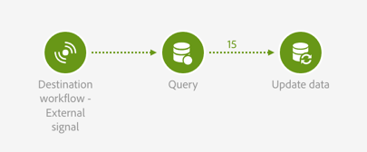

# Importazione di segnali e dati esterni {#external-signal-data-import}

L’esempio seguente illustra l’attività **[!UICONTROL External signal]** in un caso d’uso tipico. Un’importazione dati viene eseguita in un flusso di lavoro sorgente. Dopo l’importazione dei dati e l’aggiornamento del database, viene attivato un secondo flusso di lavoro. Questo secondo flusso di lavoro viene utilizzato per aggiornare un aggregato sui dati importati.

Il flusso di lavoro sorgente viene presentato come segue:

* Un’attività [Load file](../../automating/using/load-file.md) carica un file contenente nuovi dati di acquisto. Nota che il [database è stato esteso](../../developing/using/data-model-concepts.md) di conseguenza, in quanto i dati di acquisto non sono presenti per impostazione predefinita nel data mart.

  Ad esempio:

  ```
  tcode;tdate;customer;product;tamount
  aze123;21/05/2015;dannymars@example.com;A2;799
  aze124;28/05/2015;dannymars@example.com;A7;8
  aze125;31/07/2015;john.smith@example.com;A7;8
  aze126;14/12/2015;john.smith@example.com;A10;4
  aze127;02/01/2016;dannymars@example.com;A3;79
  aze128;04/03/2016;clara.smith@example.com;A8;149
  ```

* Un’attività [Riconciliazione](../../automating/using/reconciliation.md) crea i collegamenti tra i dati importati e il database in modo tale che i dati delle transazioni siano collegati correttamente a profili e prodotti.
* Un’attività [Update data](../../automating/using/update-data.md) inserisce e aggiorna la risorsa Transazioni del database con i dati in entrata.
* Un&#39;attività [End](../../automating/using/start-and-end.md) attiva il flusso di lavoro di destinazione, utilizzato per aggiornare gli aggregati.



Il flusso di lavoro di destinazione viene presentato come segue:

* Un&#39;attività [External signal](../../automating/using/external-signal.md) attende il completamento del flusso di lavoro di origine.
* Un’attività [Query](../../automating/using/query.md#enriching-data) esegue il targeting dei profili e li arricchisce con una raccolta impostata per recuperare la data dell’ultimo acquisto.
* Un’attività [Update data](../../automating/using/update-data.md) memorizza i dati aggiuntivi in un campo personalizzato dedicato. Nota che la risorsa profilo è stata estesa per aggiungere il campo **Last purchase date**.


