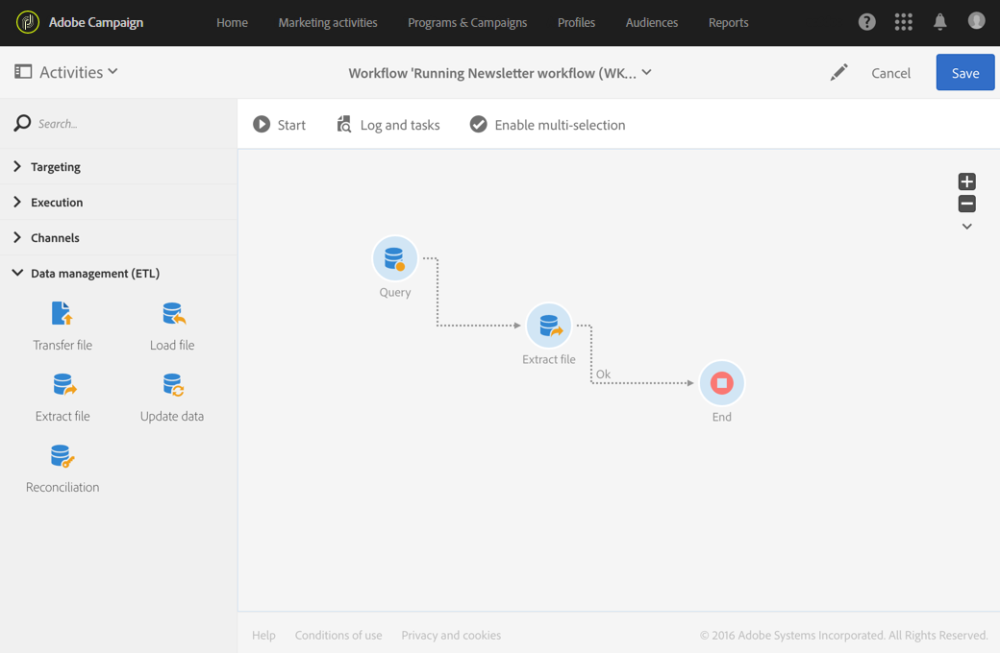
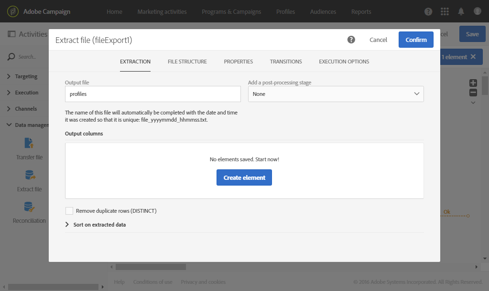
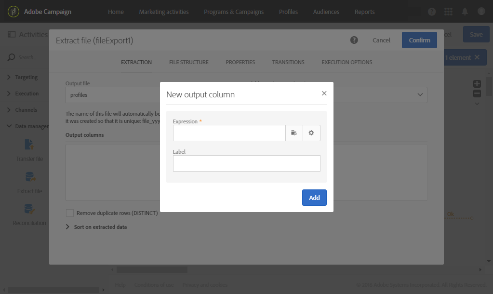
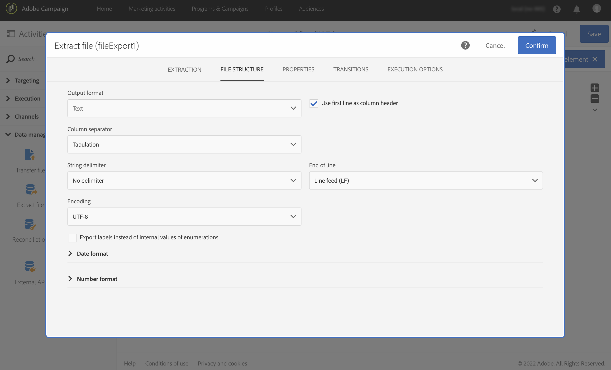

# Estrai file{#extract-file}

## Descrizione {#description}

L’attività **[!UICONTROL Extract file]** ti consente di esportare dati da Adobe Campaign sotto forma di un file esterno.

## Contesto di utilizzo {#context-of-use}

La modalità di estrazione dei dati viene definita durante la configurazione dell’attività.

>[!CAUTION]
>
>Per utilizzare l’attività **[!UICONTROL Extract file]**, devi inserirla dopo un’attività **[!UICONTROL Query]**.

**Argomenti correlati:**

* [Caso di utilizzo: esportazione di profili in un file esterno](../../automating/using/exporting-profiles-in-file.md)

## Configurazione {#configuration}

1. Trascina e rilascia un’attività **[!UICONTROL Extract file]** nel flusso di lavoro.

   

1. Seleziona l’attività, quindi aprila utilizzando il pulsante  delle azioni rapide visualizzate.
1. Immetti l’etichetta del **file di output**. L’etichetta del file viene automaticamente completata con la data e l’ora di creazione, in modo che sia univoca. Ad esempio: recipients_20150815_081532.txt per un file generato il 15 agosto 2015 alle 08:15:32.

   >[!NOTE]
   >
   >È possibile utilizzare la funzione **[!UICONTROL formatDate]** in questo campo per specificare il nome del file.

1. Se lo desideri, puoi comprimere il file di output selezionando **[!UICONTROL Compression]** nel campo **[!UICONTROL Add a post-processing stage]**. Il file di output viene compresso in un file GZIP (.gz).

   Il campo **[!UICONTROL Add a post-processing stage]** consente inoltre di crittografare un file prima di estrarlo. Per ulteriori informazioni su come utilizzare i file crittografati, consulta [questa sezione](../../automating/using/managing-encrypted-data.md)

1. Fare clic sul pulsante **[!UICONTROL Create element]** per aggiungere una colonna di output.

   

   Viene visualizzata una nuova finestra.

   

1. Immetti un’espressione. A questo scopo, puoi selezionare un’espressione esistente o crearne una nuova utilizzando l’**editor espressioni**.
1. Conferma l’espressione.

   L’espressione viene aggiunta alle colonne di output.

1. Crea tutte le colonne necessarie. Puoi modificare le colonne facendo clic sulle relative espressioni ed etichette.

   Se esporti i profili e desideri utilizzarli in uno strumento esterno, accertati di esportare un identificatore univoco. Per impostazione predefinita non tutti i profili hanno un identificatore univoco, a seconda della modalità di aggiunta al database. Per ulteriori informazioni, consulta la sezione [Generazione di un ID univoco per i profili](../../developing/using/configuring-the-resource-s-data-structure.md#generating-a-unique-id-for-profiles-and-custom-resources).

1. Fai clic sulla scheda **[!UICONTROL File structure]** per configurare i formati di output, data e numero per il file da esportare.

   Seleziona l’opzione **[!UICONTROL Export labels instead of internal values of enumerations]** nel caso dell’esportazione di valori di enumerazione. Questa opzione ti consente di recuperare etichette più brevi che sono più facili da comprendere rispetto agli ID.

   

   >[!NOTE]
   >
   >Se desideri estrarre i dati in un file CSV con una codifica specifica, seleziona innanzitutto il formato di output &quot;Testo&quot;. Scegli la codifica desiderata dall’elenco a discesa, quindi modifica il formato di output in &quot;CSV (Excel)&quot;.

1. Nella scheda **[!UICONTROL Properties]**, seleziona l’opzione **[!UICONTROL Do not generate a file if the inbound transition is empty]** per evitare di creare e caricare file vuoti sui server SFTP se la transizione in entrata è vuota.
1. Conferma la configurazione dell’attività e salva il flusso di lavoro.
