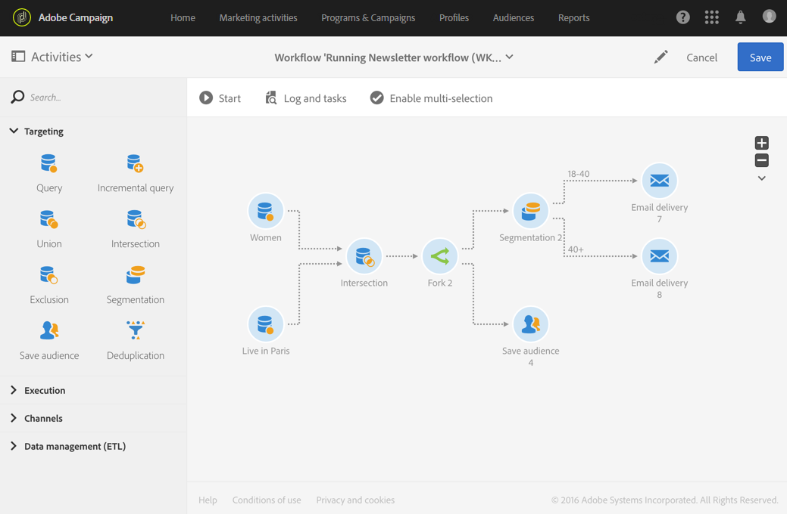

# Fork{#fork}

## Descrizione {#description}

L’attività **[!UICONTROL Fork]** ti consente di creare transizioni in uscita per avviare più attività in contemporanea.

## Contesto di utilizzo {#context-of-use}

L’attività **[!UICONTROL Fork]** ti consente di eseguire diverse attività in modo indipendente all’interno dello stesso flusso di lavoro.

## Configurazione {#configuration}

1. Trascina e rilascia un’attività **[!UICONTROL Fork]** nel flusso di lavoro.
1. Connettila alle altre attività che la precedono, come le query.
1. Seleziona l’attività, quindi aprila utilizzando il pulsante  delle azioni rapide visualizzate.
1. Specifica il numero di transizioni in uscita attraverso la creazione, l’eliminazione o la duplicazione delle transizioni. Puoi anche attribuire loro un nome e un’etichetta.
1. Conferma la configurazione dell’attività e salva il flusso di lavoro.

## Esempio {#example}

L’esempio seguente mostra un’intersezione di due attività di query che eseguono il targeting dei profili provenienti dal database di Adobe Campaign. Nel caso specifico, si tratta delle donne che vivono a Parigi. L’attività Fork ti consente quindi di utilizzare più attività in contemporanea: una che salva il pubblico per ricordare la popolazione calcolata e un’altra che segmenta la popolazione inviando due e-mail diverse con un contenuto mirato per ciascun segmento. La prima e-mail viene inviata a donne di Parigi di età compresa tra i 18 e i 40 anni; un’altra ha invece come targeting donne di Parigi di età superiore ai 40 anni.

