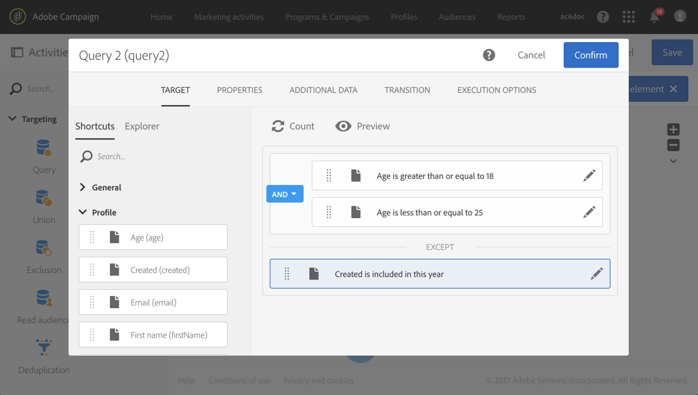

# Identificazione di duplicati prima di una consegna {#identifying-duplicates-before-a-delivery}

L’esempio seguente illustra una deduplicazione che ti consente di escludere i duplicati di un target prima di inviare un’e-mail. Ciò significa che eviti di inviare una comunicazione diverse volte allo stesso profilo.

Il flusso di lavoro è costituito da:

* Una [Query](../../automating/using/query.md) che ti consente di definire la destinazione dell&#39;e-mail. In questo caso, il flusso di lavoro esegue il targeting di tutti i profili di età compresa tra i 18 e i 25 anni presenti nel database dei clienti da oltre un anno.

  

* Un&#39;attività [Deduplication](../../automating/using/deduplication.md), che ti consente di identificare i duplicati provenienti dalla query precedente. In questo esempio viene salvato un solo record per ogni duplicato. I duplicati vengono identificati utilizzando l’indirizzo e-mail. Ciò significa che la consegna e-mail può essere inviata solo una volta per ogni indirizzo e-mail presente nel targeting.

  Il metodo di deduplicazione selezionato è **[!UICONTROL Non-empty value]**. Questo ti consente di garantire che tra i record conservati in caso di duplicati, sia data priorità a quelli in cui è stato fornito il **Nome**. Questo renderà più coerente l’utilizzo del nome nei campi di personalizzazione del contenuto dell’e-mail.

  Inoltre, viene aggiunta una transizione aggiuntiva per conservare i duplicati e per poterli elencare.

  

* Una [consegna e-mail](../../automating/using/email-delivery.md) effettuata dopo la transizione in uscita principale della deduplicazione.
* Un&#39;attività [Save audience](../../automating/using/save-audience.md) inserita dopo la transizione aggiuntiva della deduplicazione per salvare i duplicati in un pubblico **Duplicates**. Questo pubblico può essere riutilizzato per escludere direttamente i suoi membri da ogni consegna e-mail.
