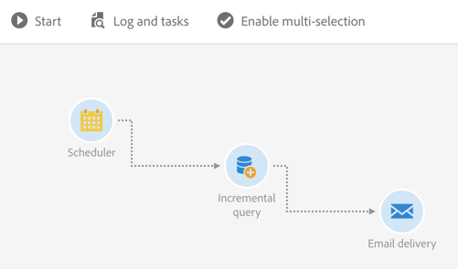
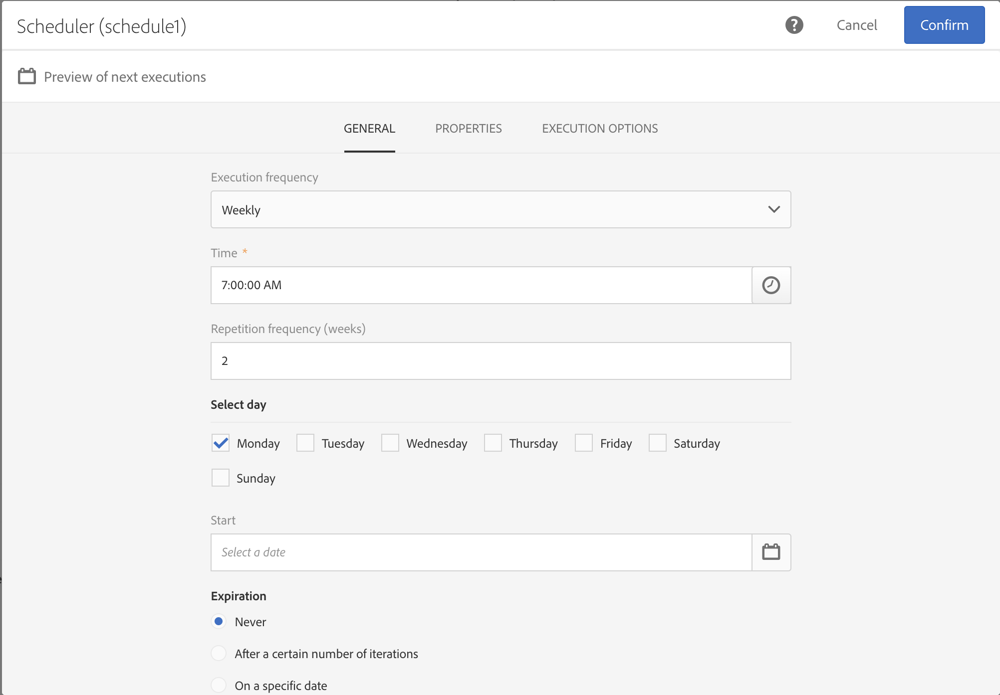

# Query incrementale per gli abbonati a un servizio {#example--incremental-query-on-subscribers-to-a-service}

L’esempio seguente mostra la configurazione di un’attività **[!UICONTROL Incremental query]** che filtra i profili abbonati al servizio **Running Newsletter** nel database di Adobe Campaign, al fine di inviare loro un messaggio e-mail di benvenuto contenente un codice promozionale.

Il flusso di lavoro è costituito dai seguenti elementi:

* Un&#39;attività [Scheduler](../../automating/using/scheduler.md), per eseguire il flusso di lavoro ogni lunedì alle 6.

  

* Un&#39;attività [Incremental query](../../automating/using/incremental-query.md), che esegue il targeting per tutti i sottoscrittori correnti durante la prima esecuzione, quindi solo per i nuovi sottoscrittori della settimana durante le esecuzioni successive.

  

* Un&#39;attività [Email delivery](../../automating/using/email-delivery.md). Il flusso di lavoro viene eseguito una volta alla settimana, ma puoi aggregare le e-mail inviate e i risultati per mese, ad esempio per generare report per un periodo di un mese intero e non per una sola settimana.

  A tale scopo, scegli di creare una **[!UICONTROL Recurring email]** che raggruppa le e-mail e i risultati **[!UICONTROL By month]**.

  Definisci il contenuto dell’e-mail e inserisci il codice promozionale di benvenuto. Per ulteriori informazioni, consulta le sezioni [Definizione del contenuto delle e-mail](../../designing/using/personalization.md).

Quindi avvia l’esecuzione del flusso di lavoro. Ogni settimana i nuovi abbonati riceveranno l’e-mail di benvenuto con il codice promozionale.
