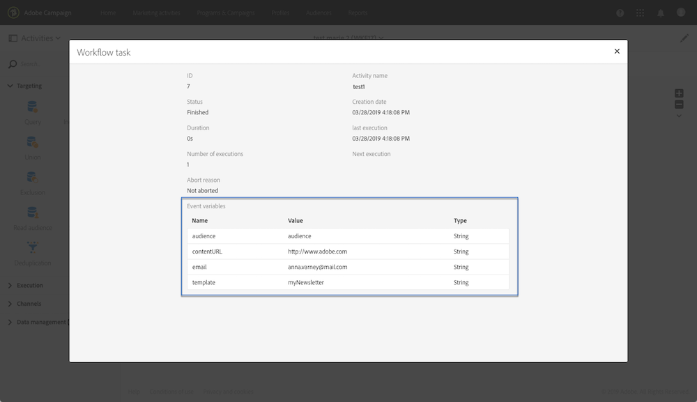

# Monitoraggio delle variabili di eventi {#monitoring-the-events-variables}

È possibile monitorare le variabili degli eventi disponibili nel flusso di lavoro, inclusi i parametri esterni dichiarati. A questo scopo, segui la procedura indicata di seguito:

1. Selezionare l&#39;attività che segue l&#39;attività **[!UICONTROL External signal]**, quindi fare clic sul pulsante **[!UICONTROL Log and tasks]**.
1. Nella scheda **[!UICONTROL Tasks]**, fare clic sul pulsante .

   

1. Viene visualizzato il contesto di esecuzione dell’attività (ID, stato, durata, ecc.), incluse tutte le variabili di eventi che sono ora disponibili per l’utilizzo nel flusso di lavoro.

   
