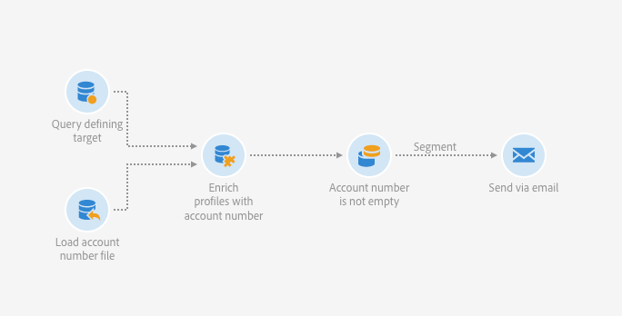
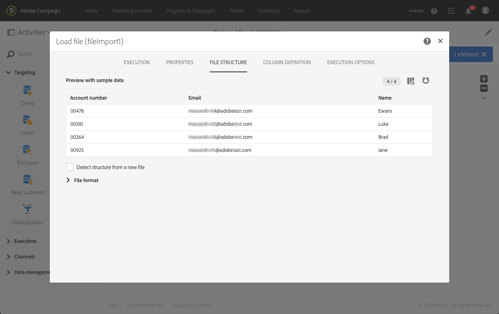
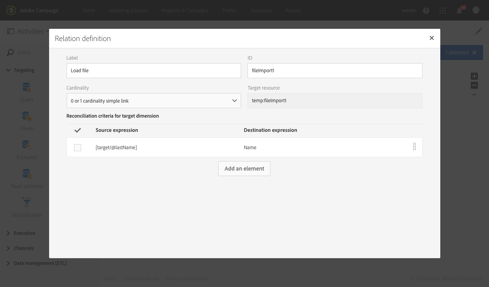
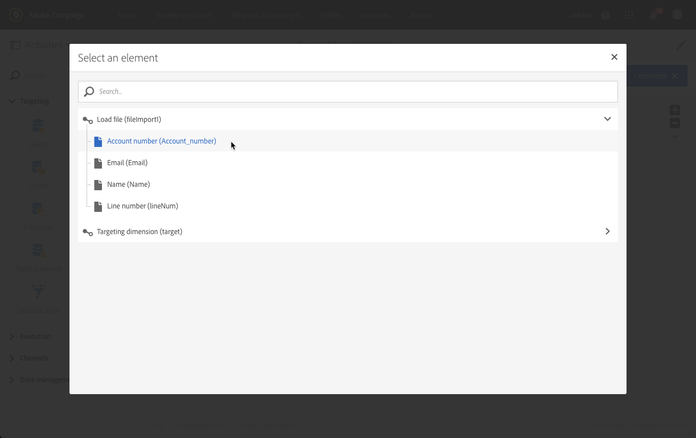
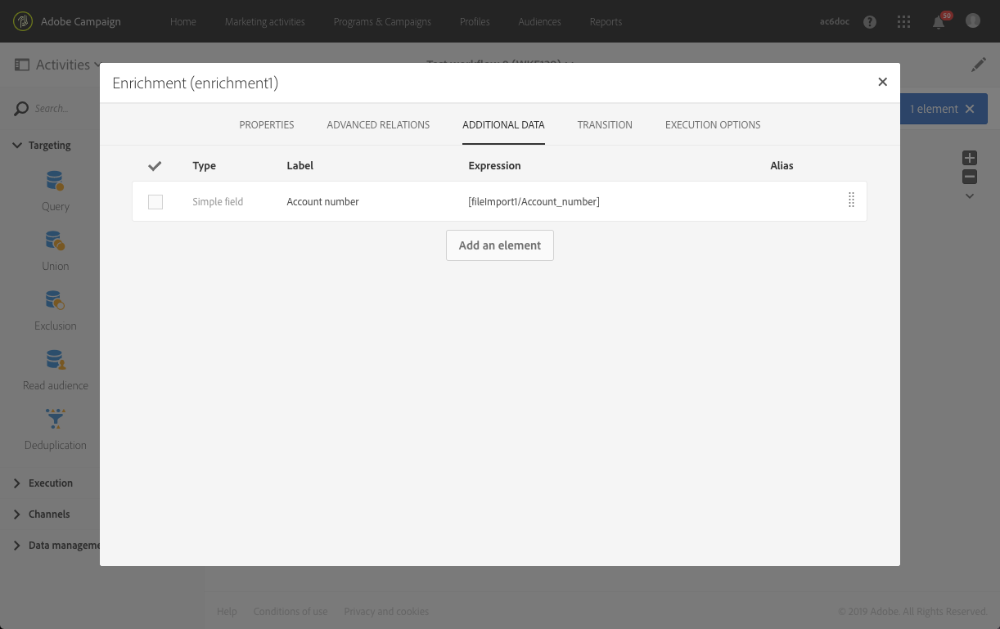
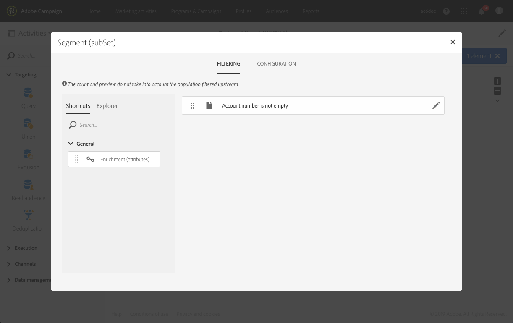
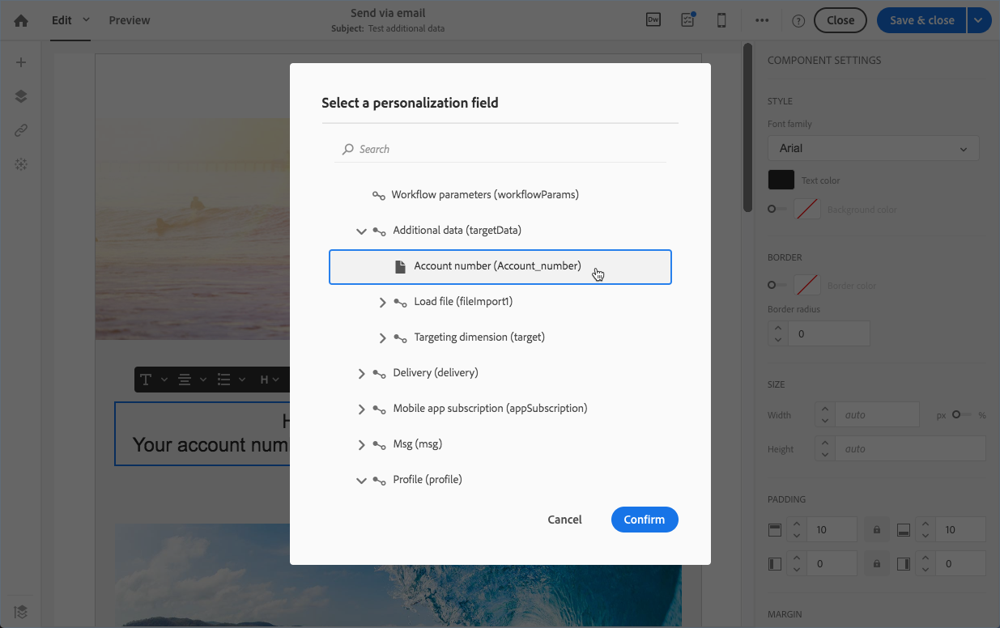
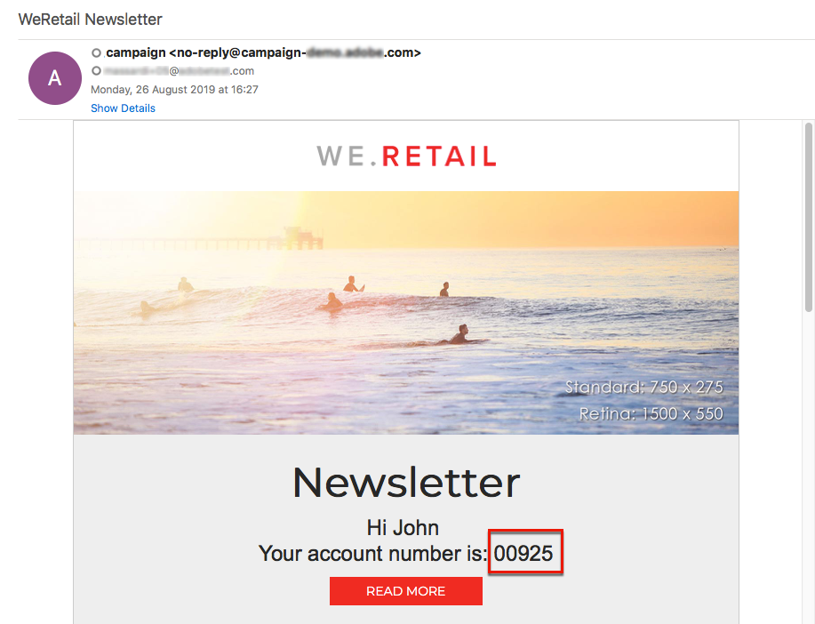

# Invio di un’e-mail con campi arricchiti {#sending-email-enriched-fields}

<!--A new example showing how to send an email containing additional data retrieved from a load file activity has been added. [Read more](example-2-email-with-enriched-fields)-->

L’attività di caricamento file consente inoltre di inviare nello stesso flusso di lavoro un’e-mail arricchita di dati aggiuntivi proveniente da un file esterno.

L’esempio seguente illustra la procedura per l’invio di un’e-mail utilizzando dati aggiuntivi recuperati da un file esterno tramite l’attività di caricamento file. In questo esempio, il file esterno contiene un elenco di profili con il relativo numero di account associato. Vorresti importare questi dati per poter inviare un messaggio e-mail a ogni profilo insieme al relativo numero di account.

Per creare il flusso di lavoro, effettua le seguenti operazioni:

1. Trascina e rilascia un&#39;attività [Query](../../automating/using/query.md) nel flusso di lavoro e aprila per definire la destinazione principale.

   <!--The Query activity is presented in the [Query](../../automating/using/query.md) section.-->

1. Trascina e rilascia un&#39;attività [Load file](../../automating/using/load-file.md) per assegnare alcuni dati a un profilo. In questo esempio, eseguirai il caricamento di un file contenente i numeri di account corrispondenti ad alcuni profili del database.

   

1. Trascina e rilascia un&#39;attività [Enrichment](../../automating/using/enrichment.md) nel flusso di lavoro e collegala alle attività di caricamento file e di query.

1. Nella scheda **[!UICONTROL Advanced relations]** dell’attività Enrichment, seleziona **[!UICONTROL 0 or 1 cardinality simple link]** e definisci i campi da utilizzare per la riconciliazione. In questo caso, utilizziamo il cognome per riconciliare i dati con i profili del database.

   

1. Nella scheda **[!UICONTROL Additional data]**, seleziona gli elementi che desideri utilizzare nel messaggio e-mail. Qui puoi selezionare il numero di account, presente nella colonna del file recuperato tramite l’attività di caricamento file.

   

   <!---->

   Per ulteriori informazioni, consulta la sezione [Enrichment](../../automating/using/enrichment.md).

1. Trascina e rilascia un&#39;attività [Segmentation](../../automating/using/segmentation.md) nel flusso di lavoro e aprila per perfezionare la destinazione principale.

   

   Per ulteriori informazioni, consulta la sezione [Segmentazione](../../automating/using/segmentation.md).

1. Trascina e rilascia un&#39;attività [Email delivery](../../automating/using/email-delivery.md) nel flusso di lavoro e aprila.

   <!--The Email delivery activity is presented in the [Email delivery](../../automating/using/email-delivery.md) section.-->

1. Aggiungi un campo di personalizzazione e seleziona dal nodo **[!UICONTROL Additional data (targetData)]** i dati aggiuntivi definiti nell’attività di arricchimento, in questo caso il numero account. Questa operazione ti consente di recuperare in modo dinamico il numero di account di ciascun profilo presente nel contenuto dell’e-mail.

   

1. Salva il messaggio e-mail e avvia il flusso di lavoro.

L’e-mail viene inviata alla destinazione. Ciascun profilo riceve l’e-mail con il numero di account corrispondente.

