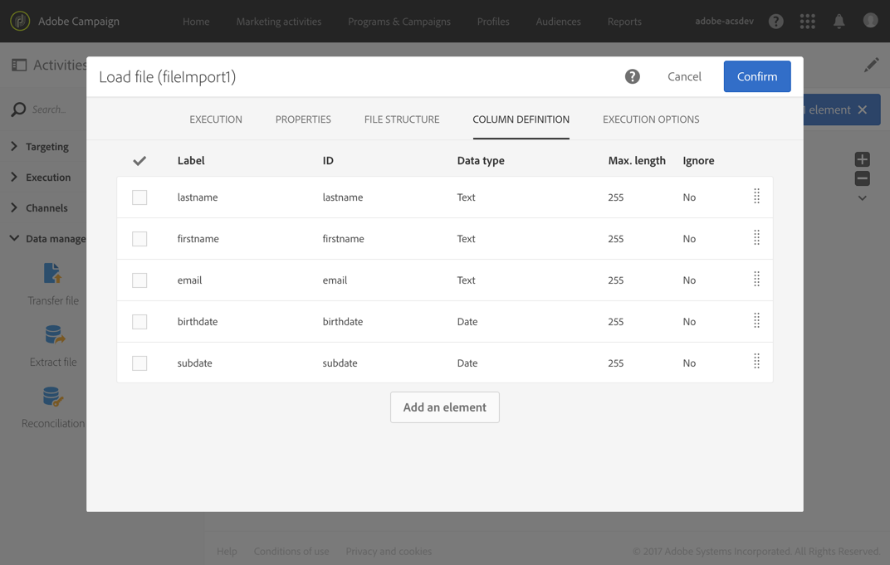
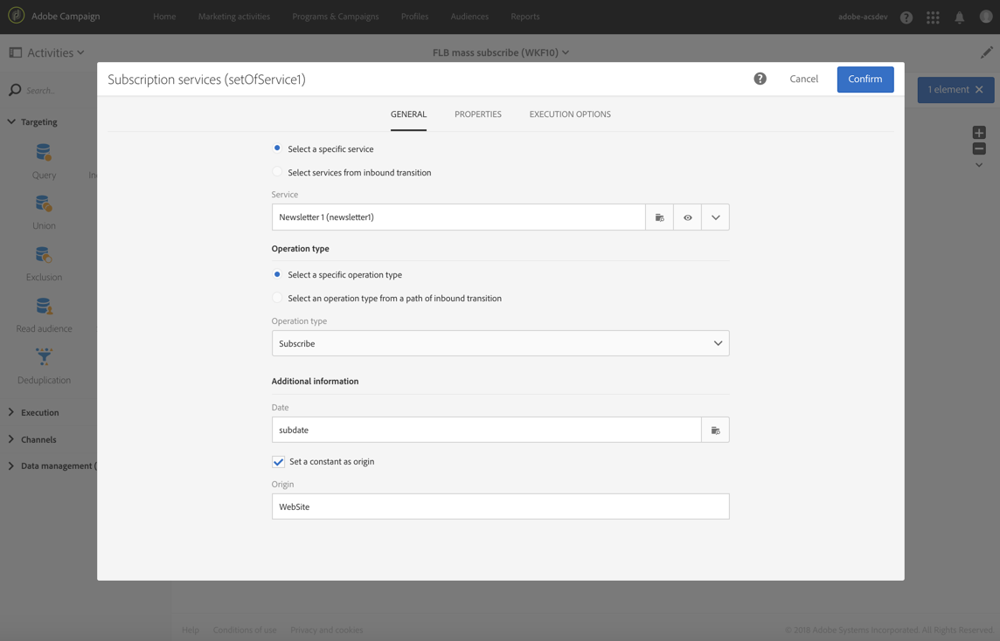

# Iscrizione di profili a un servizio specifico dopo l’importazione di un file {#subscribing-profiles-to-a-specific-service-after-importing-a-file}

Questo esempio illustra come importare un file contenente profili ed effettuarne l’abbonamento a un servizio esistente. Dopo l’importazione del file, è necessario eseguire una riconciliazione in modo tale che i dati importati possano essere identificati come profili. Per garantire che il file non contenga duplicati, sui dati verrà eseguita un’attività di deduplicazione.

Il flusso di lavoro viene presentato come segue:


* Un&#39;attività [Load file](../../automating/using/load-file.md) carica il file del profilo e definisce la struttura delle colonne importate.

  Per questo esempio, il file caricato è in formato .csv e contiene i seguenti dati:

  ```
  lastname;firstname;email;birthdate;subdate
  jackman;megan;megan.jackman@testmail.com;07/08/1975;10/08/2017
  phillips;edward;phillips@testmail.com;09/03/1986;10/08/2017
  weaver;justin;justin_w@testmail.com;11/15/1990;10/08/2017
  martin;babeth;babeth_martin@testmail.net;11/25/1964;10/08/2017
  reese;richard;rreese@testmail.com;02/08/1987;11/08/2017
  cage;nathalie;cage.nathalie227@testmail.com;07/03/1989;11/08/2017
  xiuxiu;andrea;andrea.xiuxiu@testmail.com;09/12/1992;11/08/2017
  grimes;daryl;daryl_890@testmail.com;12/06/1979;12/08/2017
  tycoon;tyreese;tyreese_t@testmail.net;10/08/1971;12/08/2017
  ```

  

* Un&#39;attività [Reconciliation](../../automating/using/reconciliation.md) identifica i dati del file come appartenenti alla dimensione di profilo del database di Adobe Campaign. Solo la scheda **[!UICONTROL Identification]** è configurata. Essa identifica i dati del file in base agli indirizzi e-mail dei profili.

  

* Una [deduplicazione](../../automating/using/deduplication.md) basata sul campo **email** della risorsa temporanea (derivante dalla riconciliazione) identifica eventuali duplicati. Se i dati importati dal file contengono duplicati, l’abbonamento a un servizio non riuscirà per tutti i dati.

  

* Un&#39;attività [Subscription Services](../../automating/using/subscription-services.md) ti consente di selezionare il servizio a cui i profili devono essere abbonati, il campo corrispondente alla data di abbonamento e l&#39;origine dell&#39;abbonamento.

  
