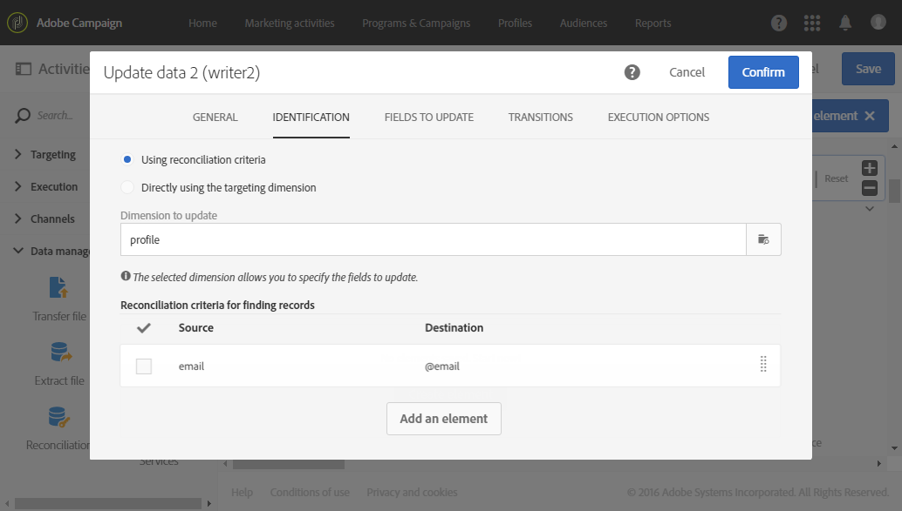
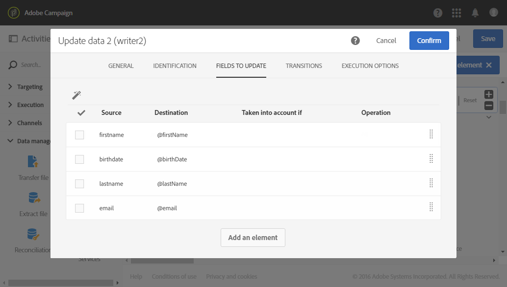

# Aggiornamento del database con dati esterni {#update-database-file}

L&#39;esempio seguente mostra la configurazione di un&#39;attività **[!UICONTROL Update data]** dopo un&#39;attività **[!UICONTROL Load file]**. Lo scopo di questo flusso di lavoro è quello di aggiungere o aggiornare i profili al database di Adobe Campaign con i dati recuperati dal file.

In questo esempio, la chiave di riconciliazione utilizzata è **indirizzo e-mail**. Il file caricato nell&#39;attività [Load file](../../automating/using/load-file.md) è un file in formato **.txt** contenente i seguenti dati di esempio:

```
lastname;firstname;email;birthdate
jackman;megan;megan.jackman@testmail.com;07/08/1975
phillips;edward;phillips@testmail.com;09/03/1986
weaver;justin;justin_w@testmail.com;11/15/1990
martin;babeth;babeth_martin@testmail.net;11/25/1964
reese;richard;rreese@testmail.com;02/08/1987
cage;nathalie;cage.nathalie227@testmail.com;07/03/1989
xiuxiu;andrea;andrea.xiuxiu@testmail.com;09/12/1992
grimes;daryl;daryl_890@testmail.com;12/06/1979
tycoon;tyreese;tyreese_t@testmail.net;10/08/1971
```

L&#39;attività [Aggiorna dati](../../automating/using/update-data.md) è configurata come segue:




