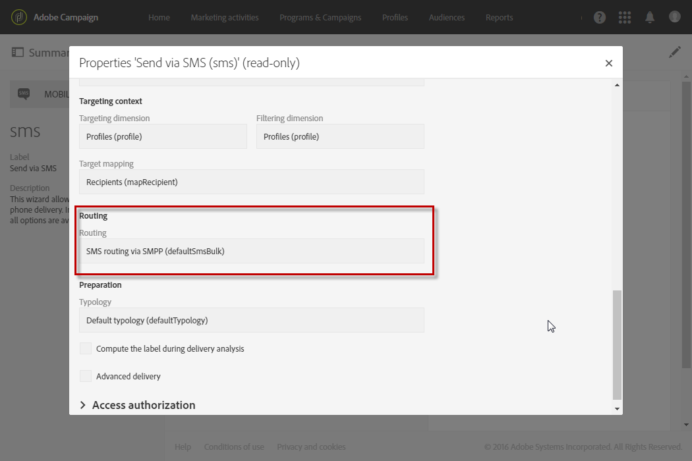

# Informazioni sui messaggi SMS{#about-sms-messages}

Adobe Campaign consente di inviare messaggi SMS (Short Message Service).

>[!NOTE]
>
>Il canale SMS è un componente aggiuntivo. Controlla il contratto di licenza.

Per i messaggi SMS, puoi creare, modificare e personalizzare i messaggi solo in formato testo. Puoi anche visualizzare in anteprima i messaggi SMS prima che vengano inviati.

La lunghezza di un messaggio SMS è limitata a 160 caratteri se è in codifica GSM e a 70 caratteri se è in Unicode. Tuttavia, alcuni caratteri speciali possono influenzare la lunghezza del messaggio. Per ulteriori informazioni, consulta la sezione [Codifica SMS](../../administration/using/configuring-sms-channel.md#sms-encoding--length-and-transliteration).

I messaggi SMS possono essere creati dal menu **[!UICONTROL Marketing activities]**, da una campagna o in un flusso di lavoro. Vedere [Creazione di un messaggio SMS](../../channels/using/creating-an-sms-message.md).

Per inviare messaggi SMS a un telefono cellulare è necessario:

* Un account esterno di **[!UICONTROL Routing]** configurato sul canale **[!UICONTROL Mobile (SMS)]** con la modalità **[!UICONTROL Bulk delivery]**. Per ulteriori informazioni, consulta la sezione [Indirizzamento](../../administration/using/configuring-sms-channel.md#defining-an-sms-routing).
* Un modello di consegna correttamente collegato a questo account esterno.

**Argomenti correlati:**

* [Gestione dei modelli](../../start/using/marketing-activity-templates.md)
* [Configurazione SMS](../../administration/using/configuring-sms-channel.md#defining-an-sms-routing)
* [Rapporto SMS](../../reporting/using/sms-report.md)
* [Guida di Campaign Standard Mobile](../../channels/using/get-started-communication-channels.md)

## Modello di consegna SMS {#sms-delivery-template}

Adobe Campaign offre un modello di consegna per dispositivi mobili. Questo modello deve essere collegato correttamente all&#39;account esterno utilizzato per il canale **[!UICONTROL Mobile (SMS)]**. Per accedervi e modificarlo:

1. Selezionare **[!UICONTROL Resources]** > **[!UICONTROL Templates]** > **[!UICONTROL Delivery templates]** dal menu avanzato.
1. Passa il puntatore del mouse sul modello **[!UICONTROL Send via SMS]** e seleziona l&#39;opzione **Duplica elemento**.
1. Seleziona il nuovo modello.
1. Fai clic sul pulsante **[!UICONTROL Edit properties]**.
1. Nella sezione **[!UICONTROL Advanced parameters]** delle proprietà del modello, assicurati che il modello sia collegato all’account esterno da utilizzare per la consegna di SMS.

   

**Argomenti correlati:**

* [Gestione dei modelli](../../start/using/marketing-activity-templates.md)
