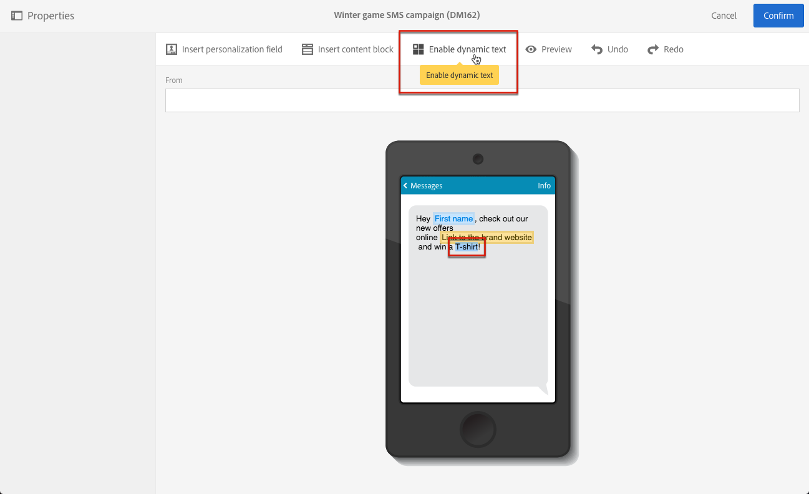
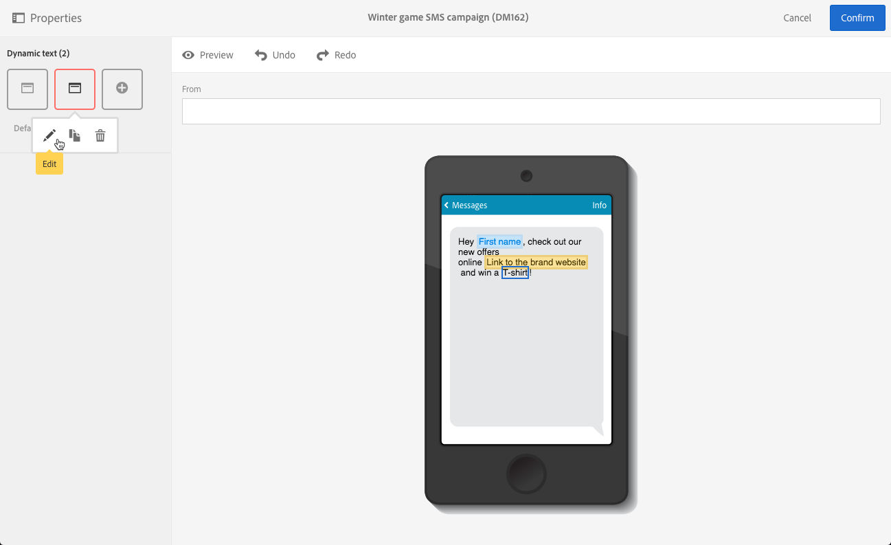
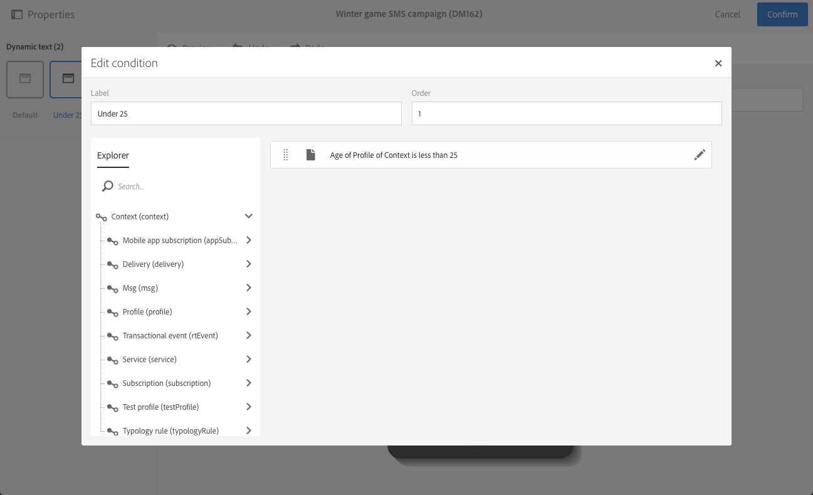
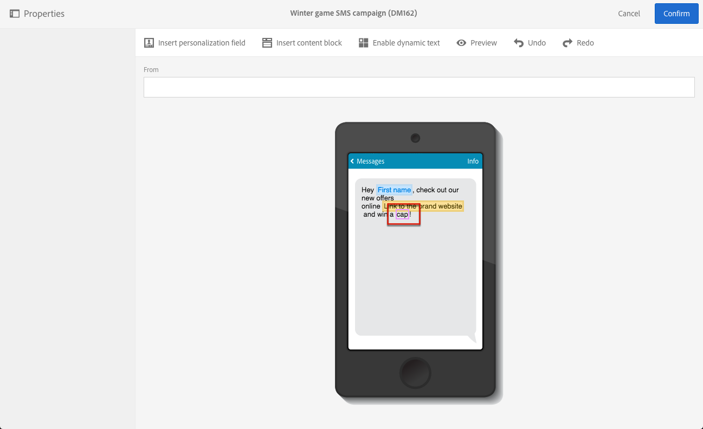

# Definizione del testo dinamico{#defining-dynamic-text}

Il testo dinamico è definito nello stesso modo del contenuto dinamico. Consulta la sezione [Definizione del contenuto dinamico](../../designing/using/personalization.md#defining-dynamic-content-in-an-email).

>[!NOTE]
>
>Per SMS e push, puoi definire solo testo dinamico. Puoi definire sia il contenuto dinamico che il testo in una pagina di destinazione. Se desideri definire il testo dinamico con [E-mail Designer](../../designing/using/designing-content-in-adobe-campaign.md), consulta [Definizione del contenuto dinamico in un messaggio e-mail](../../designing/using/personalization.md#defining-dynamic-content-in-an-email).

Le coppie surrogate, ovvero i caratteri non inclusi nel piano multilingue di base del set di caratteri Unicode, non possono essere memorizzati in 2 byte (16 bit) e devono essere codificati in 2 caratteri UTF-16. Questi caratteri includono alcuni ideogrammi CJK, la maggior parte delle emoticon e alcune lingue.
 Questi caratteri possono causare alcuni problemi di incompatibilità nel testo dinamico. Prima di inviare i messaggi, è necessario eseguire test avanzati.

L’esempio seguente mostra come definire il testo dinamico in un messaggio SMS.

1. Seleziona il testo nel corpo del messaggio o della pagina di destinazione.
1. Fai clic su **[!UICONTROL Enable dynamic text]**.

   

   L&#39;opzione **[!UICONTROL Dynamic text]** viene visualizzata nella palette. È configurato nello stesso modo del contenuto dinamico.

1. Seleziona una variante.

   

1. Definisci una condizione per questa variante.

   

Una volta definita una condizione per almeno una variante, attorno al testo dinamico viene visualizzata una cornice viola.

