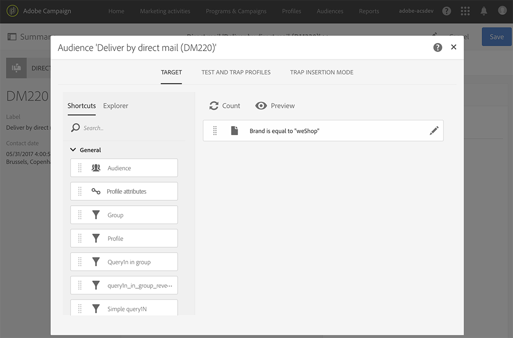
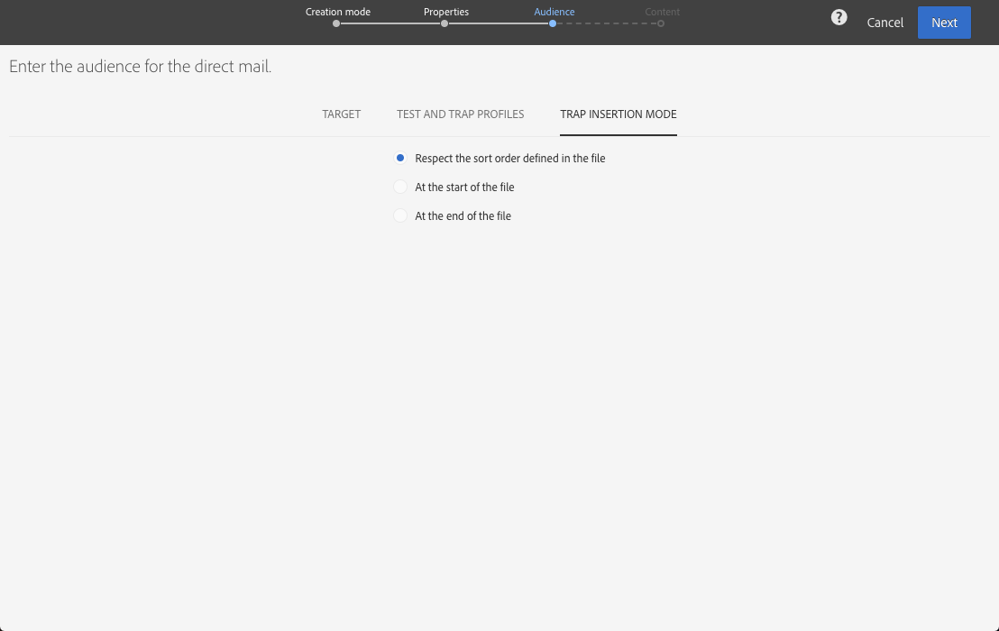

# Definizione del pubblico del direct mailing{#defining-the-direct-mail-audience}

Puoi definire il pubblico all’interno della procedura guidata di creazione oppure facendo clic sulla sezione **Audience** del dashboard di consegna.

## Definizione del target principale {#defining-the-main-target}

Per la direct mailing, i profili target sono quelli che verranno inclusi nel file di estrazione che invierai al tuo provider di direct mailing.

Per ciascun profilo target, viene aggiunta una nuova riga nel file di estrazione. La quantità di informazioni di profilo che verranno incluse per ciascun destinatario è indicata nella schermata [Definizione dell’estrazione](../../channels/using/defining-the-direct-mail-content.md#defining-the-extraction).

>[!IMPORTANT]
>
>Accertati che i profili includano un indirizzo postale, poiché queste informazioni sono essenziali per il provider di direct mailing. Inoltre, assicurati di aver selezionato la casella **[!UICONTROL Address specified]** nelle informazioni del profilo. Consulta [Consigli](../../channels/using/about-direct-mail.md#recommendations).

## Aggiunta di profili di test e di trappole {#adding-test-and-trap-profiles}

Aggiungi i profili di test in modo da poter testare il file con un numero limitato di profili. Ciò ti consente di creare rapidamente un esempio di file per effettuare la verifica e la convalida della struttura, prima di passare alla preparazione del file effettivo. Consulta [Gestione dei profili di test](../../audiences/using/managing-test-profiles.md).

L’uso di trappole è essenziale per le consegne di direct mailing. Ti consentono di verificare che il provider di direct mailing stia inviando effettivamente la comunicazione e che non stia mandando il tuo elenco dei clienti a un altro provider. Consulta [Utilizzo delle “trappole”](../../sending/using/using-traps.md).

Per le consegne di direct mailing, le trappole vengono aggiunte durante l’estrazione e unite nel documento di output. Per impostazione predefinita, le trappole vengono inserite nell’ordinamento del file di output, ma è possibile inserirle alla fine o all’inizio del file. Quando definisci il pubblico, seleziona l’opzione desiderata dalla scheda **[!UICONTROL Trap insertion mode]**.

