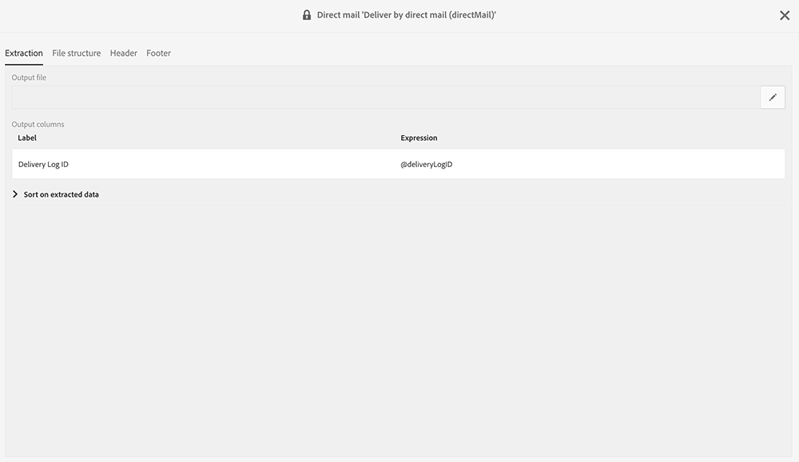
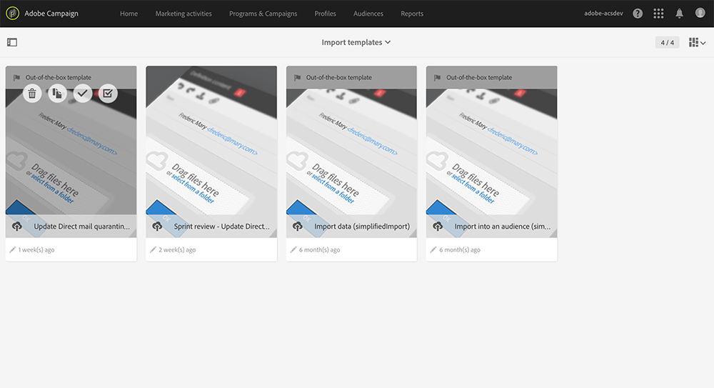

# Ritorna al mittente{#return-to-sender}

Sono supportati gli scambi di file sequenziali con i provider di Direct Mail che incorporano le informazioni di ritorno al mittente. Ciò consente di escludere gli indirizzi postali corrispondenti da comunicazioni future. Ciò ti consente anche di ricevere notifiche su un indirizzo errato e di interagire con il cliente attraverso altri canali o di incoraggiarlo ad aggiornare il proprio indirizzo postale.

Ad esempio, un contatto è stato spostato in un nuovo luogo e non ti ha fornito il nuovo indirizzo postale. Il provider recupera l’elenco degli indirizzi errati e invia queste informazioni ad Adobe Campaign, che li inserisce nell&#39;elenco Bloccati automaticamente in base all’.

Affinché questa funzionalità funzioni, il modello di consegna predefinito per la direct mailing include nel contenuto l’ID del registro di consegna. Adobe Campaign sarà quindi in grado di sincronizzare i dati di profilo e di consegna con le informazioni restituite dal provider.

Un modello di importazione è disponibile in **[!UICONTROL Adobe Campaign > Resources > Templates > Import templates > Update Direct Mail quarantines and delivery logs]**. Duplica questo modello per crearne uno personalizzato. Per ulteriori informazioni sull&#39;utilizzo dei modelli di importazione, vedere [Utilizzo dei modelli di importazione](../../automating/using/importing-data-with-import-templates.md#setting-up-import-templates).

Al termine dell’importazione, Adobe Campaign esegue automaticamente le azioni seguenti:

* Gli indirizzi non corretti vengono aggiunti al inserisco nell&#39;elenco Bloccati di a livello di profilo
* Gli indicatori principali di consegna (KPI, Delivery Main Indicators) vengono aggiornati
* I registri di consegna vengono aggiornati
