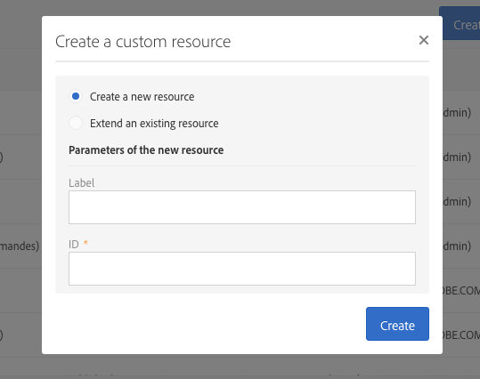
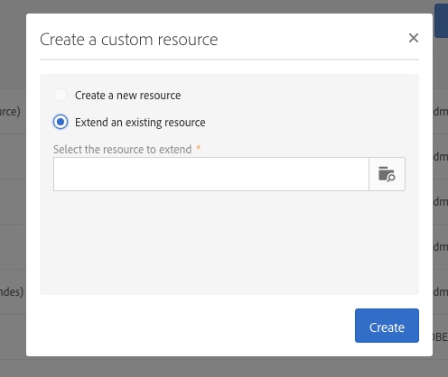

# Creazione o estensione della risorsa{#creating-or-extending-the-resource}

Se hai bisogno di lavorare su dati che non fanno parte del modello dati integrato, gli amministratori possono creare una nuova risorsa da zero o creare un’estensione di una risorsa esistente.

È possibile estendere solo le seguenti risorse incorporate:

* **[!UICONTROL Campaign (campaign)]**
* **[!UICONTROL Deliveries (delivery)]**
* **[!UICONTROL Landing page (Landingpage)]**
* **[!UICONTROL Profiles (profile)]**
* **[!UICONTROL Program (program)]**
* **[!UICONTROL Service (service)]**
* **[!UICONTROL Subscriptions to an application (appSubscriptionRcp)]**
* **[!UICONTROL Test profiles (seedMember)]**
* **[!UICONTROL Workflow (workflow)]**

Per creare o estendere una risorsa:

1. Da **[!UICONTROL Administration]** > **[!UICONTROL Development]** > **[!UICONTROL Custom Resources]**, fare clic sul pulsante **[!UICONTROL Create]**.
1. Scegliere l&#39;azione da eseguire:

   * **[!UICONTROL Create a new resource]**: immettere i campi **[!UICONTROL Label]** e **[!UICONTROL ID]**. Il campo **[!UICONTROL ID]** è obbligatorio. Se lasci vuoto il campo Etichetta, verrà automaticamente completato dall’ID.

     

     >[!NOTE]
     >
     >Utilizza un massimo di 30 caratteri.

   * **[!UICONTROL Extend an existing resource]**: selezionare la risorsa che si desidera estendere.

     

1. Fare clic su **[!UICONTROL Create]** per creare la risorsa, che assumerà quindi lo stato **[!UICONTROL Draft]** in caso di nuova risorsa o lo stato **[!UICONTROL Editing]** in caso di estensione.

La nuova risorsa viene creata e ora può essere configurata. Per ulteriori informazioni sulla configurazione della risorsa, consulta [Configurazione della struttura dati della risorsa](../../developing/using/configuring-the-resource-s-data-structure.md).
