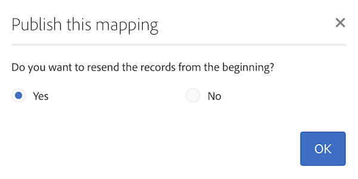
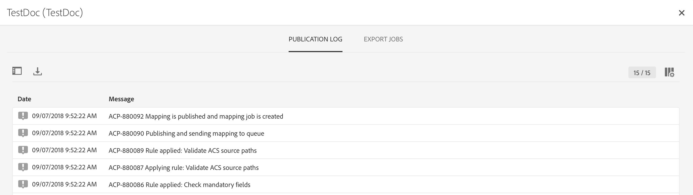
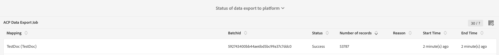
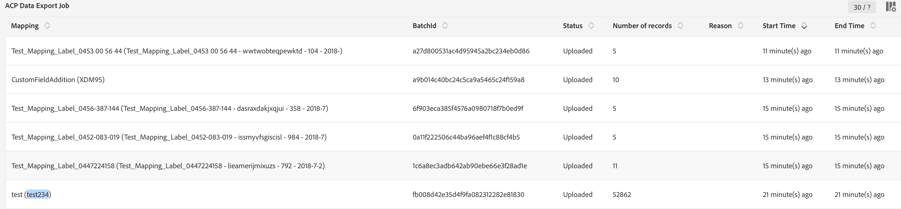
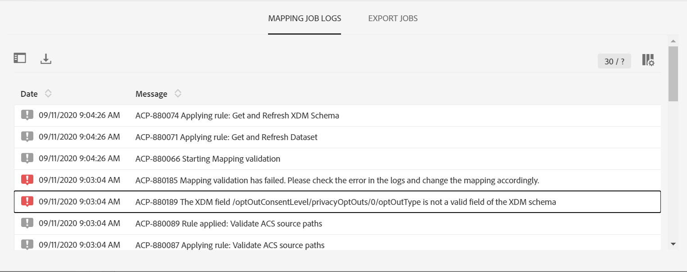
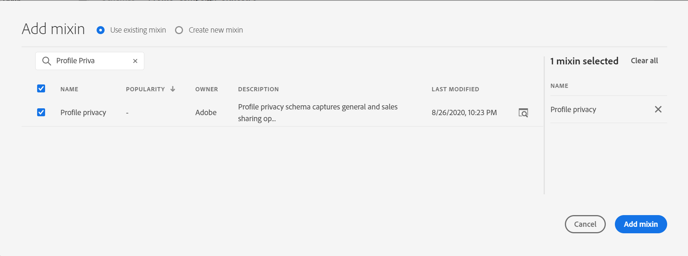
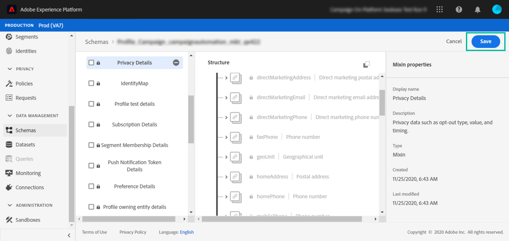

# Attivazione delle mappature {#mapping-activation}

>[!IMPORTANT]
>
>Adobe Experience Platform Data Connector è attualmente in versione beta, che potrebbe essere soggetta a frequenti aggiornamenti senza preavviso. Per accedere a queste funzionalità, i clienti devono essere ospitati su Azure (attualmente in versione beta solo per il Nord America). Per accedere, contatta l’Assistenza clienti di Adobe.

Al termine della definizione della mappatura, puoi pubblicarla. Dopo la fase di distribuzione, la replica dei dati tra Campaign Standard e Adobe Experience Platform viene avviata automaticamente. In qualsiasi momento è possibile interrompere la replica facendo clic sul pulsante **[!UICONTROL Stop]**.

A seconda delle modifiche apportate alla mappatura, puoi scegliere di inviare nuovamente tutti i record a Adobe Experience Platform.

Dal riquadro di distribuzione, puoi accedere al registro di pubblicazione e ai registri di esportazione.

Nella scheda **[!UICONTROL Export jobs]** è possibile monitorare il processo di esportazione per la mappatura pubblicata.

Per monitorare tutti i processi di esportazione dei dati, passare al menu **[!UICONTROL Administration]** > **[!UICONTROL Development]** > **[!UICONTROL Platform]** > **[!UICONTROL Status of data export to platform]**.

Gli stati dei processi di acquisizione dati sono:

* **[!UICONTROL Created]**: viene creato un processo di acquisizione dati e l&#39;acquisizione dati è in corso.
* **[!UICONTROL Failed]**: un processo di acquisizione dati non è riuscito. Il campo del motivo descrive il motivo dell’errore. Il fallimento può essere transitorio o permanente. In caso di errori transitori, viene creato un nuovo processo di acquisizione dopo un intervallo configurato. Come primo passo per la risoluzione dei problemi, l’utente può controllare il campo del motivo dell’errore. Se il motivo reindirizza un utente all’interfaccia utente di Adobe Experience Platform, l’utente può accedere a Adobe Experience Platform e controllare lo stato del batch nel set di dati per determinare il motivo esatto dell’errore.
* **[!UICONTROL Uploaded]**: viene creato un batch in Adobe Experience Platform e i dati vengono quindi acquisiti nel batch. Il campo ID batch mostra l’ID del batch in Adobe Experience Platform. Adobe Experience Platform esegue anche una convalida post sul batch. Il batch viene inizialmente contrassegnato come caricato fino al completamento del passaggio di post-convalida da parte di Adobe Experience Platform. Dopo il caricamento, un processo mantiene il polling di Adobe Experience Platform per lo stato del batch. Una batch può essere impostata su Non riuscito o su Completato dopo la convalida in Adobe Experience Platform.
* **[!UICONTROL Success]**: dopo il caricamento di un batch in Adobe Experience Platform, lo stato del processo (post convalida in Platform) viene controllato dopo un intervallo configurato. Lo stato &quot;Success&quot; (Completato) ha identificato un’acquisizione corretta dei dati in Adobe Experience Platform.

In alcuni casi, quando pubblichi la mappatura, potresti ricevere l’errore di convalida indicato di seguito.

Ciò si verifica quando lo schema XDM in uso non è stato aggiornato con il campo XDM più recente relativo alla gestione della privacy e contiene ancora il campo XDM &quot;ccpa&quot; obsoleto.

Per aggiornare lo schema XDM, effettua le seguenti operazioni:

1. Vai al set di dati su Adobe Experience Platform utilizzando il collegamento presente nella pagina di mappatura XDM.

1. Passa allo schema XDM.

1. Aggiungi il mixin **[!UICONTROL Profile Privacy]** allo schema.

   

1. Salva lo schema, quindi riprova a pubblicare il mapping. La pubblicazione dovrebbe ora passare.

   
