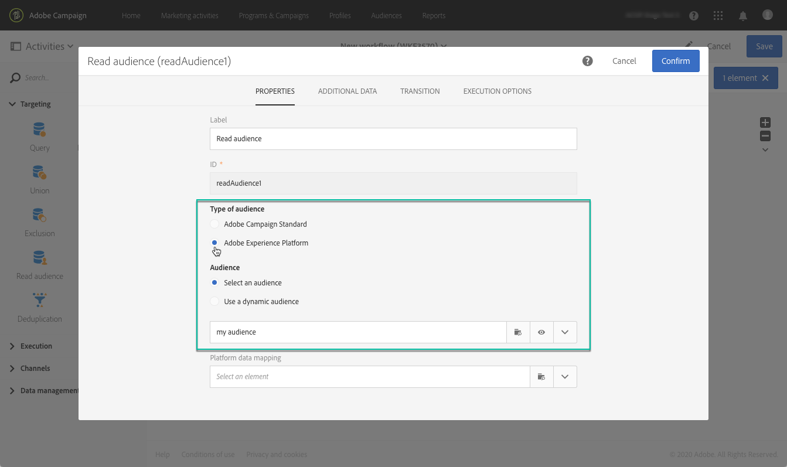

# Targeting dei tipi di pubblico di Adobe Experience Platform {#targeting-aep-audiences}

>[!IMPORTANT]
>
>Il servizio Audience Destinations è attualmente in versione beta, e potrebbe essere soggetto ad aggiornamenti frequenti senza preavviso. Per accedere a queste funzionalità, i clienti devono essere ospitati su Azure (attualmente in versione beta solo per il Nord America). Per accedere, contatta l’Assistenza clienti di Adobe.

Dopo aver creato un pubblico di [Adobe Experience Platform](../../integrating/using/aep-about-audience-destinations-service.md) utilizzando il Generatore di segmenti, puoi utilizzarlo nello stesso modo in cui lo utilizzeresti per un pubblico di Campaign all&#39;interno dei flussi di lavoro per personalizzare e inviare messaggi.

Per attivare un pubblico di Adobe Experience Platform nei flussi di lavoro, effettua le seguenti operazioni:

1. Aggiungi un&#39;attività **[!UICONTROL Read audience]** nel flusso di lavoro, quindi aprila.

1. Seleziona l&#39;opzione **[!UICONTROL Adobe Experience Platform]** in **[!UICONTROL Type of audience]**, quindi aggiungi il pubblico desiderato.

   

1. (Facoltativo) Una volta selezionato il pubblico, puoi fare clic sul pulsante con l’occhio per rivedere e/o modificare la definizione del segmento (assicurati di salvare di nuovo le modifiche).

   Facendo clic sul pulsante con l’icona a forma di occhio, accedi al Generatore di segmenti (in un’altra scheda) associato al pubblico selezionato all’interno di Campaign.

1. Selezionare un elemento **[!UICONTROL Platform data mapping]** per specificare la dimensione di targeting desiderata per il pubblico Adobe Experience Platform selezionato.

   Per impostazione predefinita, la chiave primaria (ad esempio, iRecipientID per la tabella Profilo, iAppSubscriptionID per la tabella AppSubscription) utilizzata per la riconciliazione sarà automaticamente disponibile dall’elenco a discesa. Per eseguire il targeting all&#39;esterno della chiave primaria, è necessario creare uno spazio dei nomi **personalizzato**.

   >[!NOTE]
   >
   >Per le destinazioni che non rientrano nella chiave primaria, è inoltre necessario creare una mappatura di destinazione personalizzata corrispondente allo spazio dei nomi personalizzato. Per ulteriori informazioni sulla mappatura di Target, consulta [questa sezione](../../administration/using/target-mappings-in-campaign.md).

   

   Questo elenco contiene tutte le mappature Experience Data Model (XDM) configurate nell’istanza. Per ulteriori informazioni su Adobe Experience Platform Data Connector, consulta [questo documento dedicato](../../integrating/using/aep-about-data-connector.md).

   

1. Una volta configurate correttamente le dimensioni di pubblico e targeting, fai clic sul pulsante **[!UICONTROL Confirm]** per salvare le modifiche.

Ora puoi configurare il flusso di lavoro con altre attività. È possibile, ad esempio, collegare un&#39;attività **[!UICONTROL Email delivery]** per inviare un&#39;e-mail al pubblico selezionato.

>[!NOTE]
>
>Campaign Standard consente di indirizzare il pubblico Adobe Experience Platform a tutti i canali di consegna: e-mail, messaggi SMS, messaggi direct mail, notifiche push e messaggi in-app.
>
>*Nota: per tutti i messaggi push e in-app, Campaign Standard supporta le consegne solo per i profili noti.

Per ulteriori informazioni su come utilizzare flussi di lavoro e consegne, consulta queste sezioni:

* [Esplorazione dei flussi di lavoro](../../automating/using/get-started-workflows.md)
* [Creazione di un flusso di lavoro](../../automating/using/building-a-workflow.md)
* [Esplorazione dei canali di comunicazione](../../channels/using/get-started-communication-channels.md)
* [Informazioni sulle attività del canale](../../automating/using/about-channel-activities.md)
