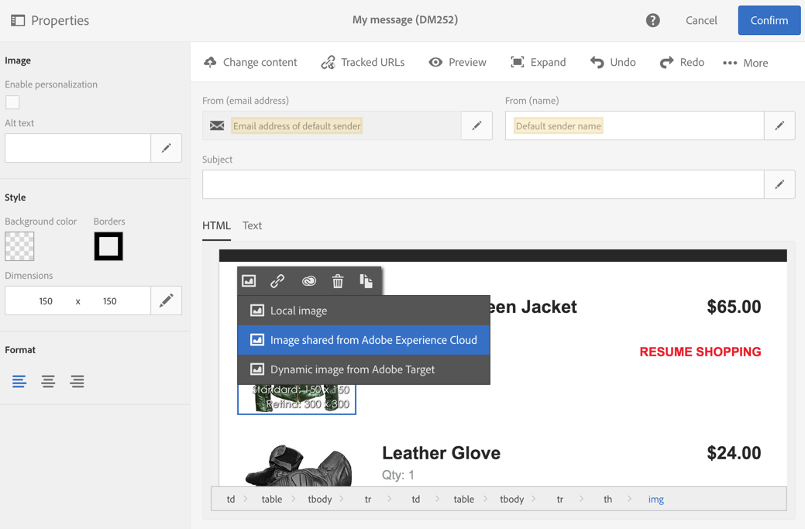

# Utilizzo di Campaign con il servizio core Assets{#working-with-campaign-and-assets-core-service}

L’integrazione del servizio di base Assets o di Assets on Demand (a seconda della configurazione dell’ambiente Adobe Experience Cloud) con Adobe Campaign consente di utilizzare tutte le risorse condivise all’interno di Adobe Experience Cloud nelle e-mail e nelle pagine di destinazione di Adobe Campaign.

L&#39;integrazione con il servizio core Assets è limitata a [amministratori funzionali](../../administration/using/users-management.md#functional-administrators).

Le risorse condivise da Adobe Experience Cloud possono essere utilizzate nelle e-mail e nelle pagine di destinazione, come segue:

1. Quando modifichi il contenuto di un&#39;e-mail o di una pagina di destinazione, passa a un blocco di immagine, quindi seleziona **[!UICONTROL Image shared from Adobe Experience Cloud]** tramite il menu contestuale.

   

1. Nella finestra di selezione visualizzata, seleziona un’immagine, quindi conferma.

   

L’immagine viene quindi inserita. Ora la consegna può essere personalizzata in base alle esigenze e inviata.

**Argomenti correlati:**

* [Assets e condivisione](https://experienceleague.adobe.com/docs/core-services/interface/assets/experience-cloud-assets.html?lang=it)
* [Editor di contenuti](../../designing/using/personalization.md#example-email-personalization)
