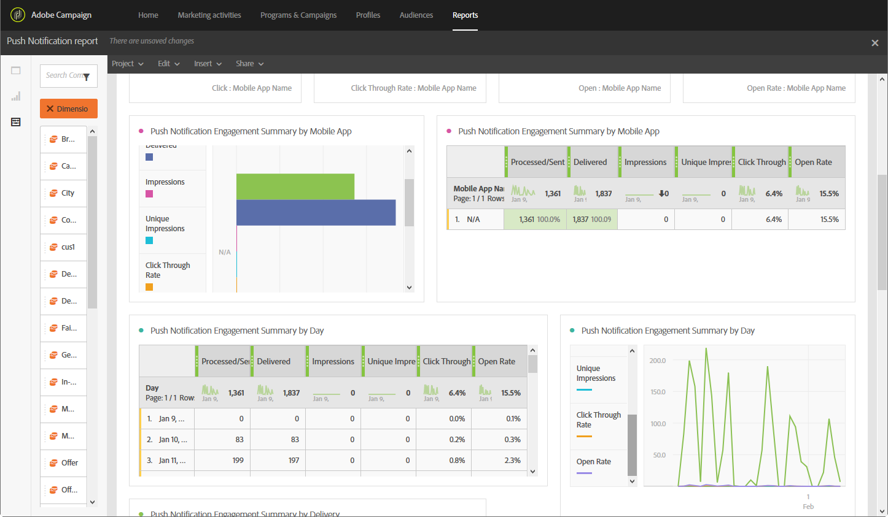
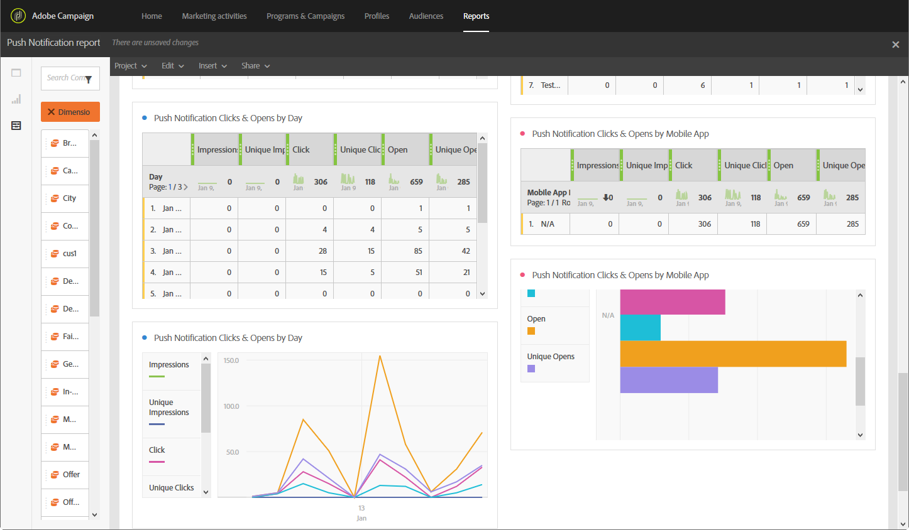

# Rapporto notifiche push{#push-notification-report}

>[!CAUTION]
>
>Tieni presente che devi trascinare e rilasciare le metriche **[!UICONTROL Message type]** nelle tabelle per suddividere i dati in base ai tipi di consegna, in questo caso le consegne di notifiche push.

Il report **Notifica push** fornisce dettagli sulle prestazioni di marketing delle notifiche push in Adobe Campaign. Questo rapporto predefinito consente di comprendere come gli utenti interagiscono con le notifiche push, le app mobili e le consegne.

Per implementare il tracciamento push è necessaria una certa configurazione nell&#39;app mobile. Per i passaggi dettagliati, consulta questa [pagina](../../administration/using/push-tracking.md).

Ogni tabella è rappresentata da numeri e grafici di riepilogo. Puoi modificare la modalità di visualizzazione dei dettagli nelle rispettive impostazioni di visualizzazione.

La prima tabella **Riepilogo coinvolgimento notifiche push** è suddivisa in tre categorie: per giorno, per app mobile e per consegna. Contiene i dati disponibili per la reattività del destinatario alla consegna:

* **[!UICONTROL Processed/sent]**: numero totale di notifiche push inviate.
* **[!UICONTROL Delivered]**: numero di notifiche push inviate correttamente, in relazione al numero totale di notifiche push inviate.
* **[!UICONTROL Impressions]**: numero di volte in cui una notifica push è stata recapitata al dispositivo e lasciata intatta nel centro notifiche. Nella maggior parte dei casi, il numero di impression deve essere simile al numero consegnato. In questo modo il dispositivo riceve il messaggio e invia nuovamente tali informazioni al server.
* **[!UICONTROL Unique impressions]**: numero di impression per destinatario.
* **[!UICONTROL Click through rate]**: percentuale di utenti che hanno interagito con la notifica push.
* **[!UICONTROL Open rate]**: percentuale di notifiche push aperte.

La seconda tabella **Clic e aperture per notifiche push** è suddivisa in tre categorie: per giorno, per app mobile e per consegna. Contiene i dati disponibili per il comportamento del destinatario per consegna:

* **[!UICONTROL Impressions]**: totale delle notifiche push visualizzate dai destinatari.
* **[!UICONTROL Unique impressions]**: numero di impression per destinatario.
* **[!UICONTROL Click]**: numero di volte in cui una notifica push è stata recapitata al dispositivo e cliccata dall&#39;utente. L’utente desidera visualizzare la notifica, che verrà quindi spostata nel tracciamento push aperto, oppure ignorarla.
* **[!UICONTROL Unique clicks]**: numero di volte in cui un utente univoco interagisce con la notifica push, ad esempio facendo clic sulla notifica o sul pulsante.
* **[!UICONTROL Open]**: numero totale di notifiche push recapitate al dispositivo e su cui gli utenti hanno fatto clic, aprendo in tal modo l&#39;app. È simile al Clic push, tranne per il fatto che l’apertura push non viene attivata se la notifica viene chiusa.
* **[!UICONTROL Unique Opens]**: numero di destinatari che hanno aperto la consegna.
