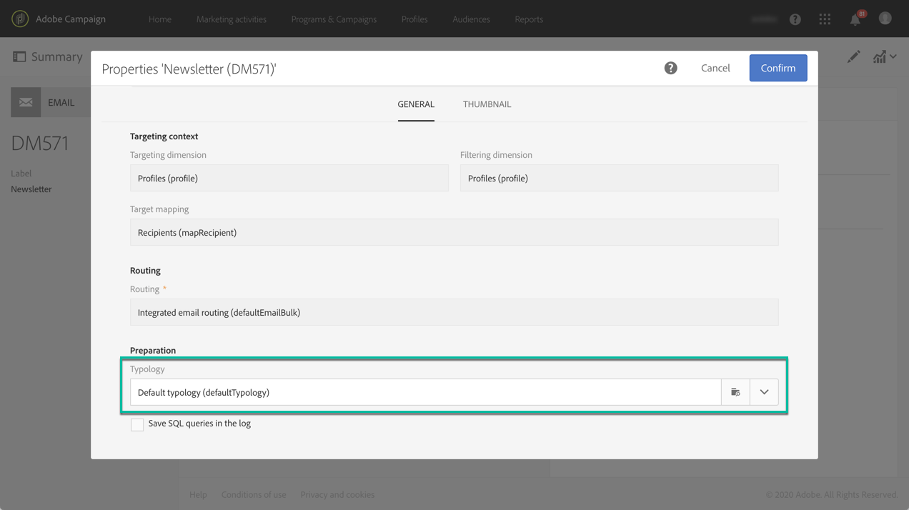

# Informazioni su tipologie e regole di tipologia{#about-typology-rules}

Campaign Standard consente di collegare un messaggio a una **tipologia** per verificarne la validità e per controllare se il messaggio soddisfa i criteri di qualità.

Le tipologie sono insiemi di **regole di tipologia** che vengono eseguite durante la fase di analisi dei messaggi. Consentono di assicurarti che le e-mail contengano sempre alcuni elementi, come  l’oggetto o un collegamento per l’annullamento dell’iscrizione, oppure regole di filtro per escludere alcuni gruppi dal target previsto (ad esempio utenti non iscritti, aziende concorrenti o clientela non fidelizzata).

Le tipologie pronte all’uso e le regole di tipologia sono disponibili all’interno di Campaign Standard. A seconda delle esigenze, puoi anche creare nuove regole e aggiungerle a tipologie nuove o esistenti per eseguire il collegamento ai messaggi.

I passaggi per la creazione e l’applicazione di una tipologia ai messaggi sono i seguenti:

1. Creare le regole di tipologia (consulta [questa sezione](../../sending/using/managing-typology-rules.md#creating-a-typology-rule)).
1. Creare una tipologia e fare riferimento alle regole create al suo interno (consulta [questa sezione](../../sending/using/managing-typologies.md#creating-a-typology)).
1. Configurare la distribuzione in modo da utilizzare la tipologia creata (consulta [questa sezione](../../sending/using/managing-typologies.md#applying-typologies-to-messages)).
1. Durante la preparazione dei messaggi, i profili vengono esclusi quando il criterio è soddisfatto. Per monitorare le esclusioni, puoi controllare i registri.
